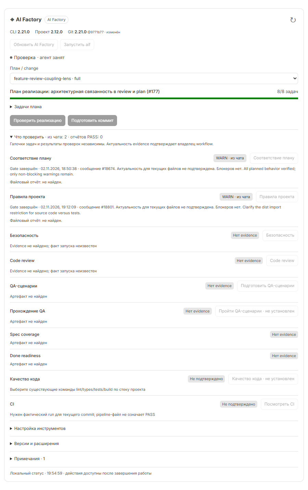
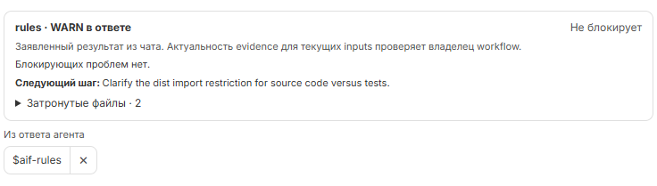
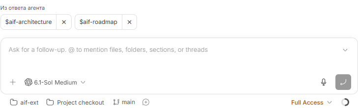
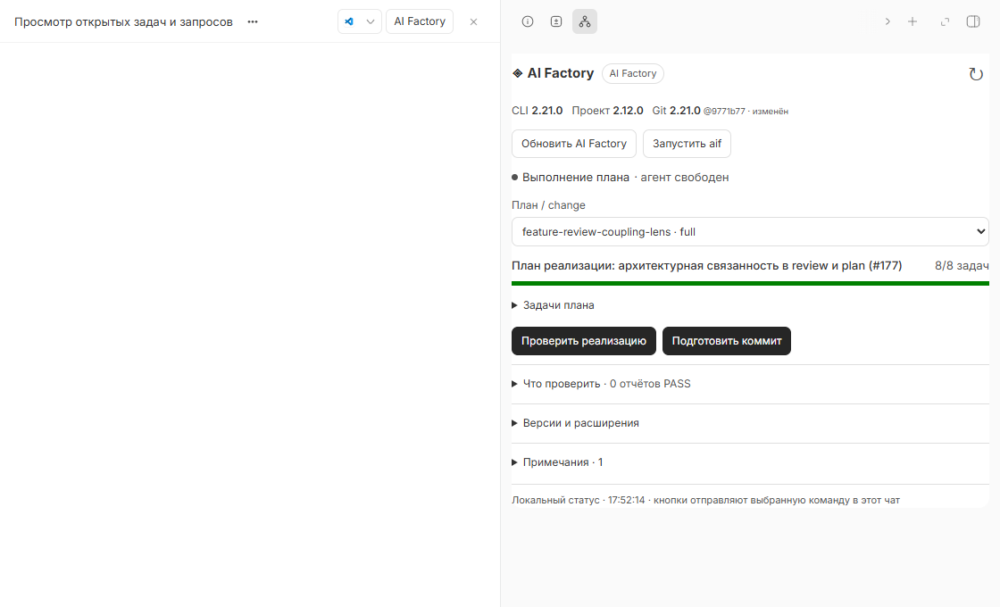
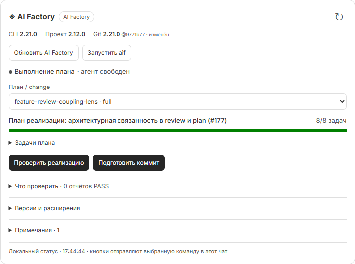

# BB AIF Helper

**Версии, следующие шаги и прогресс AI Factory/AIFHub — в постоянной панели чата BB.**

Плагин добавляет кнопку **AI Factory** в заголовок чата и открывает панель справа. Версии, установленные расширения, действия workflow и задачи плана доступны без поиска сообщений в ленте.

Версия: **0.8.36** · Статус: **experimental** · Интерфейс: **русский**.

BB plugin ID: `aif-chat`. Репозиторий: [ichinya/bb-aif-helper](https://github.com/ichinya/bb-aif-helper).

Если AI Factory в проекте не установлен, доступны кнопка **Установить AI Factory** и встроенный flow **исследование → Plan BB → выполнение → проверка → коммит**. **Составить план** включает штатный режим Plan текущего провайдера, как пункт Plan в меню BB. Готовый план отображается как Markdown-документ и сохраняется после генерации в `.bb/aif-helper/plans/`. Форма выполнения появляется под документом после успешного сохранения. Для этого не нужны внешние skills или загрузка промпта из интернета; старые планы из `.bb-aif-helper/plans/` остаются совместимыми. Исследование использует адаптированные принципы [aif-explore](https://github.com/lee-to/ai-factory/blob/2.x/skills/aif-explore/SKILL.md); это компактный базовый режим, без полного lifecycle AI Factory/AIFHub.

Кнопка **Обновить AI Factory** доступна для существующей установки и при ошибке выбранного плана/конфигурации. Ошибка продолжает блокировать обычные workflow-действия, но не скрывает возможность обновления.

Данные сохраняются в локальном SQLite-кэше плагина: повторное открытие показывает сохранённую карточку и обновляет её в фоне. Обычные запросы используют снимок до минуты; параллельные карточки объединяют чтение. **↻** принудительно перечитывает данные, а перед запуском действия сервер всегда проверяет файлы заново. Внизу карточки видны источник данных, время и состояние обновления.

Версии CLI/Git имеют отдельный суточный кэш, который не сбрасывается при обычном обновлении карточки. Проверка GitHub по кнопке также ограничена **одной попыткой за 24 часа**, включая ошибки и перезагрузки. После явного обновления установки локальные версии перечитываются. Версии установленных расширений видны в краткой строке. Значок **Версии и обновления** раскрывает кнопки обновления AI Factory и расширений, а при расхождении версий выделяется.

Значок **Показать подготовку проекта** открывает список шагов настройки. По умолчанию список скрыт. Выбранная видимость сохраняется для проекта, а в личном проекте — для рабочей папки.

В карточке переписки после начала выполнения плана запуск `aif-analyze`/`aif` находится под спойлером **Настройка контекста проекта**; во вкладке эта кнопка живёт в блоке «Подготовка проекта» (см. ниже). При неизвестном этапе и частично выполненных задачах первой предлагается **Продолжить выполнение**; завершённый список ведёт к проверке реализации. Отметки задач определяют подсказки, но не доказывают активный вызов агента или PASS.

Если Git текущего проекта показывает незакоммиченные файлы, первой предлагается **Подготовить коммит**, в том числе после архивации и без активного плана. Учитываются staged, изменённые и новые неигнорируемые файлы. Кнопка запускает отдельный `aif-commit` с проверкой diff и состава изменений; открытие карточки само коммит не создаёт.

Rules, security, review, QA, quality и CI показаны как [дополнительные ветви flow](docs/workflow.md#дополнительные-шаги-flow). В строках проверок стоит **по выбору**, а у распознанных обязательных gates — **нужно для завершения**. Для OpenSpec доступен отдельный read-only `mode doctor` выбранного change. Проверки не запускаются автоматически; требования проекта и блокирующий FAIL сохраняют силу.

[Настройки и CLI](docs/reference.md) · [Workflow и проверки](docs/workflow.md) · [Разработка](CONTRIBUTING.md) · [История изменений](CHANGELOG.md)

## Скриншоты

Секция проверок сохраняет завершённые gates из истории чата по выбранному плану. Результат `WARN · из чата` отмечается и без файлового отчёта; дата, blockers и неподтверждённая актуальность показаны отдельно. Следующие ответы не стирают результат verify.

Кнопки проверок расположены в соответствующих строках. Если после зафиксированного завершения gate входные файлы не изменились, повторная проверка отключается с пометкой **без изменений**. После изменений она снова доступна. Старые результаты без сохранённого состояния файлов и проверки с неизвестным результатом не блокируются. [Как определяется состояние файлов](docs/workflow.md#повторные-проверки).



На этом реальном кадре агент занят, поэтому кнопки временно отключены по занятости; старые результаты WARN не имеют снимка файлов и не считаются актуальными автоматически.

JSON `aif-gate-result` в сообщении свёрнут в строку **Данные gate · rules · WARN**. Раскройте её для просмотра и копирования исходного JSON. Содержимое ответа сохраняется; ошибки и незавершённый gate остаются видимыми.

При PASS допустимы `suggested_next: null` и объект с `command: null` и `reason`. Во втором случае причина показывается как **Пояснение**, без кнопки следующей команды.

Рекомендации gate поддерживают оба префикса: `/aif-fix` и `$aif-fix`. Исходный JSON сохраняется, кнопка использует формат текущего runtime. При блокирующем FAIL исправление доступно, а переход к commit/done/implement остаётся запрещён.

Новые нажатия кнопок оставляют в переписке выбранную команду (у чипа — вместе с текстом из поля ввода). Инструкции, plan/fingerprint и данные gate передаются агенту отдельным скрытым контекстом BB. История ранее отправленных сообщений не изменяется.

Обработанный `aif-gate-result`: статус, блокирующие проблемы и рекомендация следующего шага (реальный ответ в 0.3.0):



Предложения `$aif…` и `/aif…` над полем ввода, с отдельным крестиком у каждой команды. Кнопки используют префикс текущего runtime; для `aif-mode sync` сохраняется подкоманда `sync`, остальные произвольные аргументы отбрасываются. Если агент написал команду целиком в inline code (например, `` `/aif-fix refresh src/… so npm test passes` ``), чип несёт всю команду с аргументами — одна строка, до 300 символов. На кадре демонстрационные данные версии 0.2.0:



Кнопка **AI Factory** закреплена в верхнем меню чата:


После нажатия открывается постоянная панель справа. Переписка на кадре скрыта:



Прогресс плана и следующие действия в карточке AI Factory:



[Галерея: отдельные проверки и QA, версии расширений AIFHub](docs/screenshots/README.md). Кадры сняты в версии 0.1.3; окружающая переписка исключена, локальный путь скрыт. Отметки плана и результаты проверок показаны раздельно.

## Быстрый старт

Нужны [BB](https://getbb.app/) **0.48+** с совместимым SDK **0.6.104+** и Git на хосте установки. Для workflow-действий установите [AI Factory](https://github.com/lee-to/ai-factory) в рабочую папку проекта. AIFHub необязателен.

```text
bb plugin install https://github.com/ichinya/bb-aif-helper
```

BB покажет источник и запросит подтверждение установки. Git-установка собирает плагин автоматически; `dist/` в репозитории не требуется. URL отслеживает ветку по умолчанию `main`.

1. Откройте чат с рабочей средой нужного проекта.
2. Нажмите **AI Factory** в заголовке.
3. Выберите план/change, если найдено несколько кандидатов.
4. Нажмите действие — команда поступит текущему агенту в этот же чат.

Само открытие панели ничего не запускает. Без проектной установки панель покажет доступные версии; запуск отсутствующего skill останется отключённым.

## Использование

Над полем ввода появляются команды `$aif…` из последнего ответа агента. Например, `$aif-architecture` и `$aif-roadmap` отображаются отдельными кнопками; крестик **×** только убирает предложение. Скрытие сохраняется для этого текста ответа и переживает перезагрузку. При новом тексте ответа список пересобирается. Чипы команд неустановленных skills не показываются — кроме следующего шага из gate (`suggested_next`), который остаётся тусклым с причиной.

Чип с аргументами (команда, написанная агентом целиком в inline code) при пустом поле подставляет команду и отправляет сразу; голые `aif-explore`/`aif-plan`/`aif-fix` ждут тему — кроме случая, когда команду назвал `suggested_next` gate: тогда тема берётся из его `reason`, и чип тоже отправляется сразу. Режим AI Factory просит агента писать эти команды сразу с темой (`/aif-fix <что чинить>`). Если в поле уже есть текст, команда с аргументами заменяет первую строку, когда она начинается с команды, иначе встаёт первой строкой, и черновик не отправляется — фокус возвращается в поле; голая команда отправляется как `/<команда> <ваш текст>`. Пилюля режима AI Factory в черновик-команду не добавляется и убирается из него. Упоминания сдвигаются корректно. Контекст кнопки (источник ответа, fingerprint, данные gate) передаётся скрытым `experimental_data`, а не видимым сообщением. Устаревший клик по чипу или кнопке карточки показывает «Карточка обновилась…» и ничего не отправляет; до этого он завершался ошибкой RPC.

Распознаются имена команд, включая `$aif`: из обычного текста — только имя (аргументы отбрасываются, кроме `aif-mode sync`), из inline code — команда целиком с аргументами. Повторы объединяются; на одну команду — один чип, вариант с аргументами важнее голого. Показывается до 12 команд. Занятость, вопросы, очередь, актуальность ответа и установка skill перепроверяются перед отправкой. Крестик доступен и во время работы агента. Само чтение ответа ничего не запускает.

Если ответ заканчивается блоком `aif-gate-result`, над полем ввода также показаны заявленный результат gate, блокирующие проблемы, затронутые файлы и причина следующего шага. `suggested_next.command` превращается в кнопку: например, `/aif-commit` становится `$aif-commit` для Codex. `WARN` с `blocking: false` не считается блокирующей ошибкой. При блокирующем или некорректном gate нельзя запустить переход к commit/done/archive/implement через кнопки плагина. Gate из чата не подменяет свежую проверку evidence.

Кнопка с иконкой workflow в поле ввода включает **режим AI Factory** для проекта. Пока он включён, агент получает инструкции вести работу через `/aif-plan` → `/aif-implement` → `/aif-verify` → `/aif-commit` (исправления — `/aif-fix`), читать `.ai-factory/DESCRIPTION.md`, `ARCHITECTURE.md` и `.ai-factory/skill-context/` и вызывать `aif_chat_status` на границах этапов. Режим хранится на проект и не добавляется дочерним тредам. Новый верхний тред получает инструкции при старте; уже запущенная сессия их не меняет до следующей сборки сессии. Плагин сам ничего не вставляет в поле ввода. Чтобы передать режим в идущий чат (или после компакта у ACP-провайдеров), наберите `@AI Factory`: упоминание передаст агенту текст режима скрытым контекстом. Выключение режима убирает это упоминание из черновика. Если в проекте нет AI Factory, кнопка в треде открывает вкладку подготовки, а не включает режим; в новом чате без выбранного проекта она неактивна. При включённом режиме и пустом ответе агента без его команд над полем ввода показываются до трёх ближайших действий с подписью «Следующий шаг».

Постоянная кнопка **AI Factory** находится в заголовке открытого чата. Она открывает одноимённую вкладку справа с версиями, обновлением, запуском aif/aif-analyze, действиями workflow и прогрессом. Панель не зависит от положения ленты и читает данные текущего чата. На узком экране BB переносит кнопку в меню заголовка. Само открытие панели ничего не запускает.

Вкладка разделена переключателем **Навигация | Настройки** в закреплённой шапке; выбор запоминается для этого чата на сессию браузера. «Навигация» показывает текущую работу: предупреждение «Проект не подготовлен к AI Factory» с кнопкой **Подготовить** — пока не выполнены основные шаги, «Сейчас», «В работе» с дочерними тредами исполнителей и разведчиков (только когда они есть) и «Что проверить». «Настройки» собирает то, что задаётся один раз: «Подготовка проекта» (первой), «Исполнители», «Оценка кнопок», «Модели по умолчанию для новых проектов», «Настройка инструментов», «Другие команды» и «Версии и расширения» со строкой версий CLI, проекта и Git. Если в настройках есть ошибка конфигурации, доступное обновление или не выполнены основные шаги подготовки, на «Настройки» видна точка. Карточки в переписке переключателя не имеют и не изменились.

Секции панели собраны в стиле группированного списка: мелкий серый заголовок группы над блоком без рамки, строки разделены тонкими линиями. На узкой панели (контейнер уже 448 px) переключатель «Навигация | Настройки» переносится второй строкой шапки на всю ширину двумя равными половинами. Карточки в сообщениях сохраняют прежнюю вёрстку с рамками.

В «В работе» у дочернего треда видны провайдер и запрошенная модель с уровнем рассуждения — то, с чем BB отправил ход. Если провайдер подтвердил подмену (событие `provider/modelFallback` пишет только Claude Code), видна «⚠ Подмена: A → B (причина)»; если тред `AIF · …` или `AIF research · …` запущен не на модели из «Исполнителей», — «⚠ Ожидалась модель …». Для Codex и ACP тихую подмену провайдера BB не видит: показывается запрошенная модель.

После установки агенту доступен инструмент `aif_chat_status` и skill `aif-chat`. На запрос статуса или на границе workflow агент вызывает инструмент и выводит возвращённый `previewDirective` отдельной строкой. BB показывает интерактивную карточку. Дополнительный экземпляр доступен в секции AI Factory контекстной карточки чата.

```text
bb plugin run aif-chat show --phase plan --target .ai-factory/plans/my-feature.md
bb plugin run aif-chat status --json
bb plugin run aif-chat check-updates --json
```

Команды используют текущий BB thread; вне его добавьте `--thread <id>`. Карточка читает рабочую папку среды выбранного чата. Если `.ai-factory.json` отсутствует, показываются доступные версии и сообщение об отсутствии установки; соседние репозитории не выдаются за установленные расширения.

В проверенной Windows-сборке BB короткий alias `bb aif-chat ...` выдаёт результат, после чего завершается с libuv assertion. Поэтому документация и подсказки используют явный `bb plugin run aif-chat ...`, проверенный с exit code 0. Native tool и RPC не используют проблемный alias.

Кнопка отправляет выбранную команду агенту в этот же чат, сохраняя native разрешения BB и текущий черновик пользователя. Выполнение использует выбранного в BB провайдера и может расходовать его лимиты или платные запросы. Отправка не выполняется из фонового обновления. Пока агент занят, есть очередь или открыты вопросы, новый запуск не допускается. Устаревшая карточка требует обновления; повторные клики и неоднозначная доставка не создают автоматический повтор.

Рядом с версиями всегда есть отдельная группа управления, независимо от наличия/выбора плана:

- **Обновить AI Factory** — явный запрос агенту обновить существующую CLI-установку через её package manager, затем выполнить обычный `ai-factory update` для инициализированного проекта. Версии пакета и проектной установки проверяются отдельно; принудительная переустановка и замена linked checkout не выполняются.
- **Обновить расширения** — доступно при зарегистрированных расширениях. Сначала агент обновляет AI Factory CLI и установку проекта, затем выполняет `ai-factory extension update`. После этого проверяет `extension list`, записанные/установленные версии и наличие объявленных команд/skills. Ошибка предыдущего этапа останавливает переход к обновлению расширений.
- **Запустить aif** — настройка контекста проекта без AIFHub.
- **Запустить aif-analyze** — настройка через AIFHub, если его расширение установлено. Учитываются custom skills расширения, отсутствующие в базовом `installedSkills`. Если нужный skill отсутствует, кнопка отключена с пояснением.

Нажатие обновления не запускает setup, выполнение плана или проверки приложения. Без проектной установки можно обновить существующий CLI; `init` автоматически не выполняется.

Обычный `ai-factory update` уже проверяет расширения перед базовыми skills внутри своей процедуры. Завершающий `ai-factory extension update` оставляет проверку расширений после обновления проекта и может корректно сообщить `unchanged`. Правильная команда — **extension** в единственном числе, без `--all`. [Официальный контракт расширений](https://github.com/lee-to/ai-factory/blob/2.x/docs/extensions.md).

Блок **Подготовка проекта** — только то, без чего остальные команды AI Factory работают хуже. Он стоит первым в «Настройках». Основные шаги — первые три (установка, описание проекта, архитектура): пока они не выполнены, блок выделен цветной рамкой, а на «Навигации» над «Сейчас» вместо списка шагов видно предупреждение «Проект не подготовлен к AI Factory» со счётчиком и кнопкой **Подготовить**, которая открывает «Настройки» и прокручивает к блоку. После основных шагов выделение снимается, предупреждение исчезает, а необязательные шаги остаются в блоке. Девять шагов по порядку: установка AI Factory, описание проекта (`/aif` или `aif-analyze` → `DESCRIPTION.md`, `config.yaml`, `rules/base.md`, `AGENTS.md`), архитектура (`/aif-architecture`), проверки кода (`/aif-quality-setup`, готово при настроенных git-хуках), CI (`/aif-ci`), документация (`/aif-docs`; засчитывается только после запуска кнопкой из блока и при наличии папки `docs/` — одна папка ещё не доказывает документацию по методике AI Factory), правила кода (`/aif-rules` → `RULES.md`), команды сборки (`/aif-build-automation` → `Makefile`, `Taskfile.yml`, `Justfile` или `magefile.go`) и Docker (`/aif-dockerize` → `Dockerfile` или `compose.yml`). Шаги 4–9 можно пропустить. Статусы ✅/⬜ ставятся по фактическому наличию файлов с учётом путей из `config.yaml`. Справа в строке — кнопка **Запустить** (у первого невыполненного шага залитая) и у шагов 4–9 кнопка **Пропустить** / **Вернуть**; отметка пропуска хранится по папке проекта. Нажатие на название или «?» раскрывает описание шага. Когда все шаги выполнены или пропущены, блок сворачивается в строку «Проект готов к работе через AI Factory». Полный список с пропуском шагов доступен во вкладке «Настройки». Кнопка со списком в шапке показывает или скрывает краткую «Подготовку проекта» в «Навигации» и карточках. Краткий блок по умолчанию скрыт.

В «Настройках» блок **Исполнители** задаёт четыре роли — **Код**, **Разведчик 1**, **Разведчик 2**, **Разведчик 3**. У каждой роли вся строка — кнопка: первая строка — название, вторая — текущая модель и уровень рассуждения мелким серым, справа «›»; нажатие раскрывает тот же редактор («Этот агент / Другая модель», провайдер, модель, уровень рассуждения, «Сохранить») только у меняемой роли, пояснения — под «?».

**Код** — кто пишет код задач плана: агент этого чата или другая модель BB (провайдер, модель, уровень рассуждения). Сохранение записывает `phases.implement` в `.ai-factory.json` и управляемый блок в `.ai-factory/skill-context/aif-implement/SKILL.md`: `/aif-implement` остаётся координатором и делегирует каждую задачу дочернему BB-треду нативными `bb thread list/spawn/wait/output/tell` — проектного скрипта нет. Повтор той же задачи использует тред `AIF · <plan> · <taskId>`; сохранение выбора удаляет старые `.ai-factory/bin/bb-aif-run.mjs`, `dispatchAgents.bb` и `dispatch`. Статус исполнителей обновляется по событиям дочерних тредов. Возврат к «Этот агент» убирает только добавленное. `phases.implement` другого агента панель не меняет.

**Разведка** — на какой модели запускать разведчиков (Explore) навыков `/aif-plan`, `/aif-fix`, `/aif-qa` и других: сохранение пишет управляемый блок в `.ai-factory/skill-context/global-skill-context.md` (его читают все навыки AI Factory), и агент запускает разведчиков параллельными дочерними тредами `AIF research · <skill> · <topic>` через `bb thread spawn`, а не встроенными помощниками провайдера. `.ai-factory.json` при этом не меняется. Разведчиков три, и у каждого своя строка и своя модель: 1 — архитектура и затронутые модули (он же единственный, если навык просит одного), 2 — шаблоны и соглашения, 3 — зависимости и связи (и все следующие). Разведчики 2 и 3 по умолчанию работают как разведчик 1 — в редакторе это пункт «Как разведчик 1».

**Параллельное выполнение** появляется у роли **Код**, когда выбран «Другая модель»: переключатель **Параллельно** (Выкл · 2 · 3 · 4) под строкой роли. При включении независимые задачи плана `/aif-implement` идут одновременно: координатор сам читает план по правилам агента AI Factory `implement-coordinator` (слои по `(depends on …)` и фазам, пометки `<!-- parallel: … -->`, `[~]`, `[!]`), каждую задачу слоя отправляет отдельному дочернему треду в его собственной копии проекта: копию создаёт BB через провайдер сред плагина `aif-chat-worktree` и сам удаляет её через 5 минут после архивации треда. Работает и когда папка — раздел внутри большого git-репозитория, а корень проекта BB не репозиторий, затем по одному переносит правки патчами с проверкой каждой задачи. Копия каждого исполнителя получает и незакоммиченную работу координатора, поэтому следующий слой видит результат предыдущего без промежуточных коммитов, а коммиты идут только там, где их задаёт план. Все шаги с git и запуском исполнителей выполняют команды плагина (`spawn-worker`, `bring-back`), а не команды оболочки агента, поэтому пути с пробелами, кириллицей и Windows-пути их не ломают. Ускорения не будет, если задачи правят один файл, зависят друг от друга или короткие: такие задачи идут по очереди, а задачи коммита и выкатки выполняет только координатор. Сбои координатор разбирает сам и повторяет до 3 раз на одну причину; владельца спрашивает при чужих незакоммиченных изменениях, противоречии требованиям или той же ошибке в третий раз. OpenSpec change и fix-план идут последовательно.

Под «Исполнителями» — свёрнутый блок **Модели по умолчанию для новых проектов** с краткой сводкой четырёх ролей и кнопками «Взять из этого проекта», «Применить к этому проекту», «Очистить». Умолчания хранятся один раз на установку BB (ключ `delegation-defaults`) и общие для всех проектов и машин этого BB; отдельных пикеров нет — источник всегда настройка какого-то проекта.

Применяются умолчания автоматически один раз: когда панель видит проект с установленным AI Factory, у которого все четыре роли — «Этот агент», сервер записывает их теми же файлами, что ручное сохранение (`.ai-factory.json` → `phases.implement` и блоки skill-context), показывает «Применены модели по умолчанию: …» и больше не повторяет. Ручное сохранение любой роли тоже отмечает проект. Если `phases.implement` принадлежит другому агенту, роль «Код» пропускается — применяются только разведчики. Это запись файлов в репозиторий проекта: изменения остаются некоммиченными.

Блок **Оценка кнопок** в «Настройках» (выключен по умолчанию) добавляет к чипам квадратную метку вероятности. При двух и более доступных командах сервер один раз на ответ агента спрашивает Gemini Decisions API (модель `gemini-decision-1`) и сортирует кнопки по вероятности, самую вероятную подсвечивает. В Google уходят только последний ответ агента (обрезанный до 20 000 символов) и список команд-кандидатов. Ключ API берётся из Env Catalog — хранится только имя записи, значение читается перед каждым запросом через env-catalog — или вводится вручную как секретная настройка `decisionsKey` (значение во вкладку не попадает). Результат кэшируется на ответ; ошибка или таймаут оставляют чипы без процентов, а причина показана в блоке без автоматических повторов. В журнал плагина не пишутся ни ключ, ни текст ответа.

### Внешние разведчики `/aif-scout`

Встроенный навык `/aif-scout` — поисковый слой DrMax в BB: документы автора Reddit Mapper Total 2.2.0 и руководство по поисковому слою Cocoon Engine X4 v7 лежат в `skills/aif-scout/references/` без изменений (SHA-256 в `SKILL.md`). Навык ищет в интернете боли, язык аудитории, критерии выбора, спрос, противоречия и пробелы, когда исследованию или трудному решению нужны внешние факты.

- **Что адаптировано:** только привязка к BB — без модулей кокона (TGA, GIST, Cocoon Pilot), команды оригинала пишутся обычным текстом после `/aif-scout`, реальный поиск включён по умолчанию, результаты лежат в `.ai-factory/scout/<slug>-<время>/`, независимые ветви поиска идут параллельными разведчиками.
- **Модели:** разведчики запускаются дочерними тредами `AIF research · aif-scout · <angle-id>` на моделях «Разведчик 1–3» из блока «Исполнители» панели (он есть в проектах с установленным AI Factory); при `self`, без AI Factory или при недоступности `bb thread spawn` разведчиками становятся собственные субагенты агента.
- **Где лежат результаты:** только в `.ai-factory/scout/<slug>-<время>/` (`plan.md`, `corpus/<angle-id>.md`, `report.md`). Переносит выводы в `RESEARCH.md` команда `/aif-explore ultra "<тема>" по .ai-factory/scout/<slug>-<время>/report.md` (путь к отчёту нужен: сам `/aif-explore` эту папку не ищет).

### Планы и карточки в чате

- **Одна карточка на тред.** В ленте видна только последняя карточка AI Factory; старые исчезают и больше ничего не читают. Пока агент ждёт ответа на вопрос или подтверждения, карточка в ленте скрыта, а панель и карточка контекста пишут «ожидается подтверждение пользователя» и отключают кнопки.
- **Документ плана.** План в блоке `aif-plan` показывается документом: после завершения генерации он сохраняется в `.bb/aif-helper/plans/`, под ним появляются ссылка на файл и кнопки плана. Прерванный план не сохраняется и не запускается.
- **Исследовать задачу.** Кнопка открывает форму описания (до 4000 символов); черновик переживает обновление и ошибку отправки. После выполненного плана — отдельная кнопка **Исследовать новую задачу**, выбор плана сбрасывается.
- **Список планов.** Завершённые планы скрыты за флажком **Показать завершённые (N)**; у плана видно «выполнено N из M», «закрыт» и «План отмечен проверенным».
- **AI Factory 2.22 и AIFHub.** Настройки плана (коммиты, метод, TDD), пропущенные задачи и задачи-коммиты, кнопки с пометкой «нужен CLI 2.22+»; устаревший SessionBrief блокирует выполнение и предлагает пересборку.
- **Подсказки.** После предложений `/aif-improve` появляется **Применить всё**: его отправляет сервер, черновик в поле не трогается. Под недоступным чипом написана причина — видна и на телефоне.

## Workflow

- Upstream: explore → plan → необязательный improve → implement → необязательный verify → commit. Project-required checks сохраняются.
- AIFHub classic/OpenSpec: после plan предлагается improve; после implement — verify; подтверждённые ошибки — fix → verify; затем проверка готовности и отдельный done.
- Новый баг без findings в AIFHub идёт к plan, а не непосредственно fix.
- Legacy ultra делегируется upstream, а done проверяет receipt и возвращает точный handoff. OpenSpec ultra остаётся canonical change.
- «Что проверить»: verify, rules, security, review, подготовка/прохождение QA, read-only аудит quality и просмотр CI. Настройка quality/CI вынесена отдельно.

## Источники и ограничения

Версии глобального npm CLI, `.ai-factory.json`, локального Git checkout и удалённого Git показываются отдельно. Проверка GitHub выполняется только кнопкой или `check-updates`; по умолчанию выбирается последний стабильный release, можно задать конкретный ref. Кэш содержит время проверки. Чтение статуса ничего не устанавливает/обновляет и не импортирует JS команд расширений. Обновление выполняет текущий агент по явному нажатию соответствующей кнопки.

Отметки задач берутся из canonical plan, `index.md` или OpenSpec `tasks.md`. Из файлов gates читается последний валидный `aif-gate-result`. Статус `PASS в отчёте` означает именно содержимое отчёта: актуальность evidence для текущих inputs подтверждает владелец workflow. Плагин не создаёт QA evidence, не присваивает проверкам PASS, не архивирует и не редактирует планы. Факт наличия test-cases, coverage или pipeline не считается прохождением QA/CI.

Для отсутствующих receipts, legacy folder-only планов, нестандартной структуры или неполных данных показывается ограничение. Автоматическая миграция не выполняется. Готовность к done всегда перепроверяет владелец. Кнопки не заменяют критерии приёмки проекта, Handoff или существующий AIFHub Flow.

Карточка ничего не опрашивает по таймеру. Все карточки, вкладка и подсказки читают данные через общий кэш запросов BB: одинаковые карточки делают один запрос, неизменённый ответ не перерисовывает экран. Обновление приходит, когда сервер помечает данные треда устаревшими: по событиям треда и его дочерних тредов, после действий в панели и при изменении служебных файлов проекта (`.ai-factory/`, `.github/`, `docs/`, корневых `*.md`, `*.yml`, `*.json`), за которыми следит нативный наблюдатель BB, пока карточка открыта. Правка исходного кода обновления не вызывает. После переподключения BB данные перечитываются сами. Phase указывает агент, а занятость/открытые вопросы берутся из BB. Плагин не угадывает активную команду по времени изменения файлов. Открытая история может показывать старый заявленный этап; текущие задачи и отчёты перечитываются.

## Обновление плагина

Для BB AIF Helper, установленного из Git:

```text
bb plugin outdated
bb plugin update aif-chat
```

Это обновляет сам плагин BB. Кнопка **Обновить AI Factory** и команда `check-updates` относятся к AI Factory: кнопка запрашивает обновление, команда только проверяет удалённую версию.

## Настройки

В Settings → Plugins → AI Factory Chat или через `bb plugin config aif-chat`:

- `enabled` — включить/отключить запросы карточек; по умолчанию `true`.
- `sourceRepo` — необязательный путь к checkout исходников AI Factory на хосте; не прикладной проект.
- `runtime` — по умолчанию `auto`; при нескольких несовпадающих установках выберите явно.
- `upstreamRepo` — GitHub owner/repository; по умолчанию `lee-to/ai-factory`.
- `upstreamRef` — пусто для последнего стабильного release либо конкретный ref.

[Все значения, примеры CLI и устранение проблем](docs/reference.md).

`bb plugin run aif-chat reset` сбрасывает только UI selection/phase. `reset-dispatch` применяется вручную после проверки неоднозначной доставки. Эти команды не меняют проект.

## Сборка и установка

Требуется BB >=0.48 и Plugin SDK 0.6.104. React предоставляется самим BB.

```text
npm ci --include=dev
npm run typecheck
npm test
bb plugin build .
bb plugin install . --yes
bb plugin reload aif-chat
```

Build создаёт server, frontend и self-contained host bundles в `dist/`. Source находится в `reader.ts` (read-only сбор фактов), `workflow.ts` (маршруты), `server.ts` (RPC/CLI/agent tool), `app.tsx` (UI), `contract.ts` и `model.ts` (wire schemas).

Fixture-тесты проверяют маршруты, испорченные metadata, nested tasks, отсутствие выполнения extension modules, stale/double-click/uncertain delivery, pending questions и UI через официальный BB test harness. Ни inference, ни пользовательские workflow в тестах не запускаются.

Проверенная среда: Windows, BB 0.48.1, SDK 0.6.104, Node.js 24.13.0. Другие ОС отдельно не проверены. GitHub-запросы используют публичные endpoints без токена; закрытый upstream и превышение лимитов API могут приводить к ошибке проверки версии.

Подробности: [разработка](CONTRIBUTING.md) и [отчёт проверки 0.8.0](VERIFICATION.md). Публикация в npm или BB Community Marketplace не выполнялась. Ошибки и предложения: [GitHub Issues](https://github.com/ichinya/bb-aif-helper/issues).
