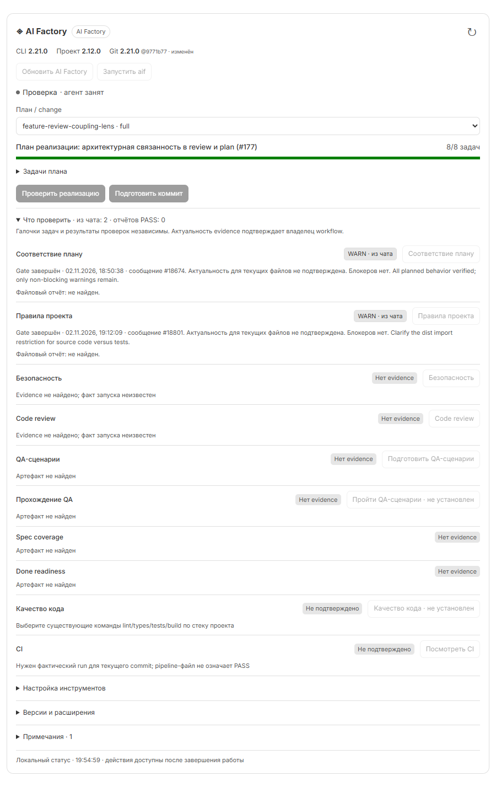
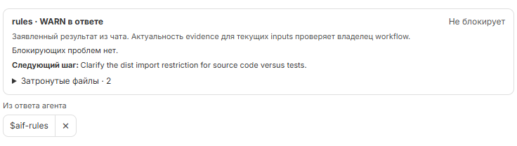
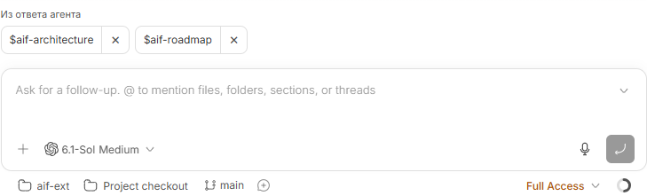
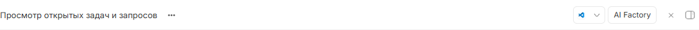
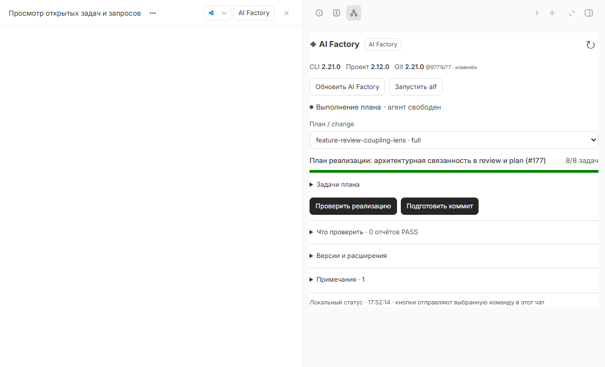
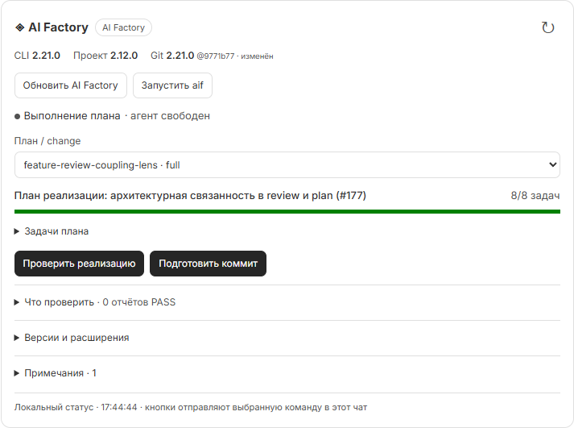

# BB AIF Helper

**Версии, следующие шаги и прогресс AI Factory/AIFHub — в постоянной панели чата BB.**

Плагин добавляет кнопку **AI Factory** в заголовок чата и открывает панель справа. Версии, установленные расширения, действия workflow и задачи плана доступны без поиска сообщений в ленте.

Версия: **0.6.0** · Статус: **experimental** · Интерфейс: **русский**.

BB plugin ID: `aif-chat`. Репозиторий: [ichinya/bb-aif-helper](https://github.com/ichinya/bb-aif-helper).

Кнопка **Обновить AI Factory** доступна для существующей установки и при ошибке выбранного плана/конфигурации. Ошибка продолжает блокировать обычные workflow-действия, но не скрывает возможность обновления.

Данные сохраняются в локальном SQLite-кэше плагина: повторное открытие показывает сохранённую карточку и обновляет её в фоне. Обычные запросы используют снимок до минуты; параллельные карточки объединяют чтение. **↻** принудительно перечитывает данные, а перед запуском действия сервер всегда проверяет файлы заново. Внизу карточки видны источник данных, время и состояние обновления.

[Настройки и CLI](docs/reference.md) · [Workflow и проверки](docs/workflow.md) · [Разработка](CONTRIBUTING.md) · [История изменений](CHANGELOG.md)

## Скриншоты

Секция проверок сохраняет завершённые gates из истории чата по выбранному плану. Результат `WARN · из чата` отмечается и без файлового отчёта; дата, blockers и неподтверждённая актуальность показаны отдельно. Следующие ответы не стирают результат verify.

Кнопки проверок расположены в соответствующих строках. Если после зафиксированного завершения gate входные файлы не изменились, повторная проверка отключается с пометкой **без изменений**. После изменений она снова доступна. Старые результаты без сохранённого состояния файлов и проверки с неизвестным результатом не блокируются. [Как определяется состояние файлов](docs/workflow.md#повторные-проверки).



На этом реальном кадре агент занят, поэтому кнопки временно отключены по занятости; старые результаты WARN не имеют снимка файлов и не считаются актуальными автоматически.

JSON `aif-gate-result` в сообщении свёрнут в строку **Данные gate · rules · WARN**. Раскройте её для просмотра и копирования исходного JSON. Содержимое ответа сохраняется; ошибки и незавершённый gate остаются видимыми.

При PASS допустимы `suggested_next: null` и объект с `command: null` и `reason`. Во втором случае причина показывается как **Пояснение**, без кнопки следующей команды.

Новые нажатия кнопок оставляют в переписке только выбранную команду. Инструкции, plan/fingerprint и данные gate передаются агенту отдельным скрытым контекстом BB. История ранее отправленных сообщений не изменяется.

Обработанный `aif-gate-result`: статус, блокирующие проблемы и рекомендация следующего шага (реальный ответ в 0.3.0):



Предложения `$aif…` над полем ввода, с отдельным крестиком у каждой команды (демонстрационные данные в версии 0.2.0):



Кнопка **AI Factory** закреплена в верхнем меню чата:



После нажатия открывается постоянная панель справа. Переписка на кадре скрыта:



Прогресс плана и следующие действия в карточке AI Factory:



[Галерея: отдельные проверки и QA, версии расширений AIFHub](docs/screenshots/README.md). Кадры сняты в версии 0.1.3; окружающая переписка исключена, локальный путь скрыт. Отметки плана и результаты проверок показаны раздельно.

## Быстрый старт

Нужны [BB](https://getbb.app/) **0.48+** с совместимым SDK **0.6.104+** и Git на хосте установки. Для workflow-действий установите [AI Factory](https://github.com/lee-to/ai-factory) в рабочую папку проекта. AIFHub необязателен.

```text
bb plugin install https://github.com/ichinya/bb-aif-helper
```

BB покажет источник и запросит подтверждение установки. Git-установка собирает плагин автоматически; `dist/` в репозитории не требуется. URL отслеживает ветку по умолчанию `main`.

1. Откройте чат с рабочей средой нужного проекта.
2. Нажмите **AI Factory** в заголовке.
3. Выберите план/change, если найдено несколько кандидатов.
4. Нажмите действие — команда поступит текущему агенту в этот же чат.

Само открытие панели ничего не запускает. Без проектной установки панель покажет доступные версии; запуск отсутствующего skill останется отключённым.

## Использование

Над полем ввода появляются команды `$aif…` из последнего ответа агента. Например, `$aif-architecture` и `$aif-roadmap` отображаются отдельными кнопками. Нажатие запускает выбранный установленный skill через текущего агента; крестик **×** только убирает предложение. Скрытие сохраняется для этого текста ответа и переживает перезагрузку. При новом тексте ответа список пересобирается. Черновик в поле ввода не заменяется.

Распознаются имена команд, включая `$aif`, без переноса аргументов или окружающего текста. Повторы объединяются; показывается до 12 команд. Занятость, вопросы, очередь, актуальность ответа и установка skill перепроверяются перед отправкой. Крестик доступен и во время работы агента. Само чтение ответа ничего не запускает.

Если ответ заканчивается блоком `aif-gate-result`, над полем ввода также показаны заявленный результат gate, блокирующие проблемы, затронутые файлы и причина следующего шага. `suggested_next.command` превращается в кнопку: например, `/aif-commit` становится `$aif-commit` для Codex. `WARN` с `blocking: false` не считается блокирующей ошибкой. При блокирующем или некорректном gate нельзя запустить переход к commit/done/archive/implement через кнопки плагина. Gate из чата не подменяет свежую проверку evidence.

Постоянная кнопка **AI Factory** находится в заголовке открытого чата. Она открывает одноимённую вкладку справа с версиями, обновлением, запуском aif/aif-analyze, действиями workflow и прогрессом. Панель не зависит от положения ленты и читает данные текущего чата. На узком экране BB переносит кнопку в меню заголовка. Само открытие панели ничего не запускает.

После установки агенту доступен инструмент `aif_chat_status` и skill `aif-chat`. На запрос статуса или на границе workflow агент вызывает инструмент и выводит возвращённый `previewDirective` отдельной строкой. BB показывает интерактивную карточку. Дополнительный экземпляр доступен в секции AI Factory контекстной карточки чата.

```text
bb plugin run aif-chat show --phase plan --target .ai-factory/plans/my-feature.md
bb plugin run aif-chat status --json
bb plugin run aif-chat check-updates --json
```

Команды используют текущий BB thread; вне его добавьте `--thread <id>`. Карточка читает рабочую папку среды выбранного чата. Если `.ai-factory.json` отсутствует, показываются доступные версии и сообщение об отсутствии установки; соседние репозитории не выдаются за установленные расширения.

В проверенной Windows-сборке BB короткий alias `bb aif-chat ...` выдаёт результат, после чего завершается с libuv assertion. Поэтому документация и подсказки используют явный `bb plugin run aif-chat ...`, проверенный с exit code 0. Native tool и RPC не используют проблемный alias.

Кнопка отправляет выбранную команду агенту в этот же чат, сохраняя native разрешения BB и текущий черновик пользователя. Выполнение использует выбранного в BB провайдера и может расходовать его лимиты или платные запросы. Отправка не выполняется из фонового опроса. Пока агент занят, есть очередь или открыты вопросы, новый запуск не допускается. Устаревшая карточка требует обновления; повторные клики и неоднозначная доставка не создают автоматический повтор.

Рядом с версиями всегда есть отдельная группа управления, независимо от наличия/выбора плана:

- **Обновить AI Factory** — явный запрос агенту обновить существующую CLI-установку через её package manager, затем выполнить обычный `ai-factory update` для инициализированного проекта. Версии пакета и проектной установки проверяются отдельно; принудительная переустановка и замена linked checkout не выполняются.
- **Обновить расширения** — доступно при зарегистрированных расширениях. Сначала агент обновляет AI Factory CLI и установку проекта, затем выполняет `ai-factory extension update`. После этого проверяет `extension list`, записанные/установленные версии и наличие объявленных команд/skills. Ошибка предыдущего этапа останавливает переход к обновлению расширений.
- **Запустить aif** — настройка контекста проекта без AIFHub.
- **Запустить aif-analyze** — настройка через AIFHub, если его расширение установлено. Учитываются custom skills расширения, отсутствующие в базовом `installedSkills`. Если нужный skill отсутствует, кнопка отключена с пояснением.

Нажатие обновления не запускает setup, выполнение плана или проверки приложения. Без проектной установки можно обновить существующий CLI; `init` автоматически не выполняется.

Обычный `ai-factory update` уже проверяет расширения перед базовыми skills внутри своей процедуры. Завершающий `ai-factory extension update` оставляет проверку расширений после обновления проекта и может корректно сообщить `unchanged`. Правильная команда — **extension** в единственном числе, без `--all`. [Официальный контракт расширений](https://github.com/lee-to/ai-factory/blob/2.x/docs/extensions.md).

## Workflow

- Upstream: explore → plan → необязательный improve → implement → необязательный verify → commit. Project-required checks сохраняются.
- AIFHub classic/OpenSpec: после plan предлагается improve; после implement — verify; подтверждённые ошибки — fix → verify; затем проверка готовности и отдельный done.
- Новый баг без findings в AIFHub идёт к plan, а не непосредственно fix.
- Legacy ultra делегируется upstream, а done проверяет receipt и возвращает точный handoff. OpenSpec ultra остаётся canonical change.
- «Что проверить»: verify, rules, security, review, подготовка/прохождение QA, read-only аудит quality и просмотр CI. Настройка quality/CI вынесена отдельно.

## Источники и ограничения

Версии глобального npm CLI, `.ai-factory.json`, локального Git checkout и удалённого Git показываются отдельно. Проверка GitHub выполняется только кнопкой или `check-updates`; по умолчанию выбирается последний стабильный release, можно задать конкретный ref. Кэш содержит время проверки. Чтение статуса ничего не устанавливает/обновляет и не импортирует JS команд расширений. Обновление выполняет текущий агент по явному нажатию соответствующей кнопки.

Отметки задач берутся из canonical plan, `index.md` или OpenSpec `tasks.md`. Из файлов gates читается последний валидный `aif-gate-result`. Статус `PASS в отчёте` означает именно содержимое отчёта: актуальность evidence для текущих inputs подтверждает владелец workflow. Плагин не создаёт QA evidence, не присваивает проверкам PASS, не архивирует и не редактирует планы. Факт наличия test-cases, coverage или pipeline не считается прохождением QA/CI.

Для отсутствующих receipts, legacy folder-only планов, нестандартной структуры или неполных данных показывается ограничение. Автоматическая миграция не выполняется. Готовность к done всегда перепроверяет владелец. Кнопки не заменяют критерии приёмки проекта, Handoff или существующий AIFHub Flow.

Карточка обновляется при событиях BB и раз в 15 секунд, пока вкладка видима; таймер удаляется при размонтировании. Phase указывает агент, а занятость/открытые вопросы берутся из BB. Плагин не угадывает активную команду по времени изменения файлов. Открытая история может показывать старый заявленный этап; текущие задачи и отчёты перечитываются.

## Обновление плагина

Для BB AIF Helper, установленного из Git:

```text
bb plugin outdated
bb plugin update aif-chat
```

Это обновляет сам плагин BB. Кнопка **Обновить AI Factory** и команда `check-updates` относятся к AI Factory: кнопка запрашивает обновление, команда только проверяет удалённую версию.

## Настройки

В Settings → Plugins → AI Factory Chat или через `bb plugin config aif-chat`:

- `enabled` — включить/отключить запросы карточек; по умолчанию `true`.
- `sourceRepo` — необязательный путь к checkout исходников AI Factory на хосте; не прикладной проект.
- `runtime` — по умолчанию `auto`; при нескольких несовпадающих установках выберите явно.
- `upstreamRepo` — GitHub owner/repository; по умолчанию `lee-to/ai-factory`.
- `upstreamRef` — пусто для последнего стабильного release либо конкретный ref.

[Все значения, примеры CLI и устранение проблем](docs/reference.md).

`bb plugin run aif-chat reset` сбрасывает только UI selection/phase. `reset-dispatch` применяется вручную после проверки неоднозначной доставки. Эти команды не меняют проект.

## Сборка и установка

Требуется BB >=0.48 и Plugin SDK 0.6.104. React предоставляется самим BB.

```text
npm ci --include=dev
npm run typecheck
npm test
bb plugin build .
bb plugin install . --yes
bb plugin reload aif-chat
```

Build создаёт server, frontend и self-contained host bundles в `dist/`. Source находится в `reader.ts` (read-only сбор фактов), `workflow.ts` (маршруты), `server.ts` (RPC/CLI/agent tool), `app.tsx` (UI), `contract.ts` и `model.ts` (wire schemas).

Fixture-тесты проверяют маршруты, испорченные metadata, nested tasks, отсутствие выполнения extension modules, stale/double-click/uncertain delivery, pending questions и UI через официальный BB test harness. Ни inference, ни пользовательские workflow в тестах не запускаются.

Проверенная среда: Windows, BB 0.48.1, SDK 0.6.104, Node.js 24.13.0. Другие ОС отдельно не проверены. GitHub-запросы используют публичные endpoints без токена; закрытый upstream и превышение лимитов API могут приводить к ошибке проверки версии.

Подробности: [разработка](CONTRIBUTING.md) и [отчёт проверки 0.6.0](VERIFICATION.md). Публикация в npm или BB Community Marketplace не выполнялась. Ошибки и предложения: [GitHub Issues](https://github.com/ichinya/bb-aif-helper/issues).
