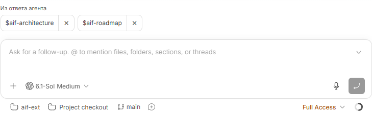
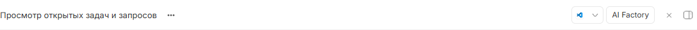
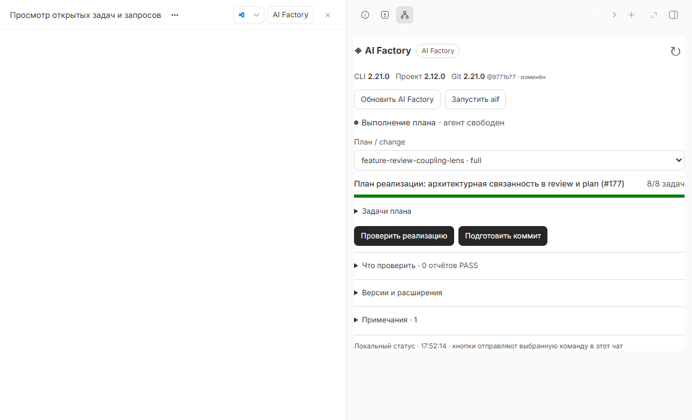
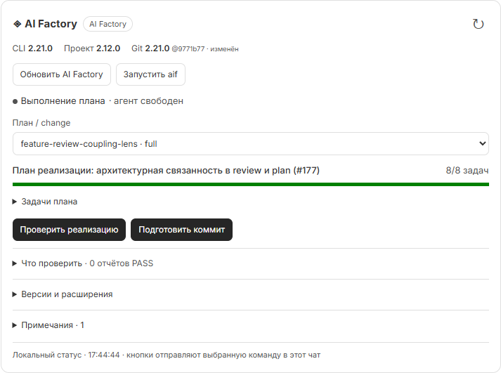
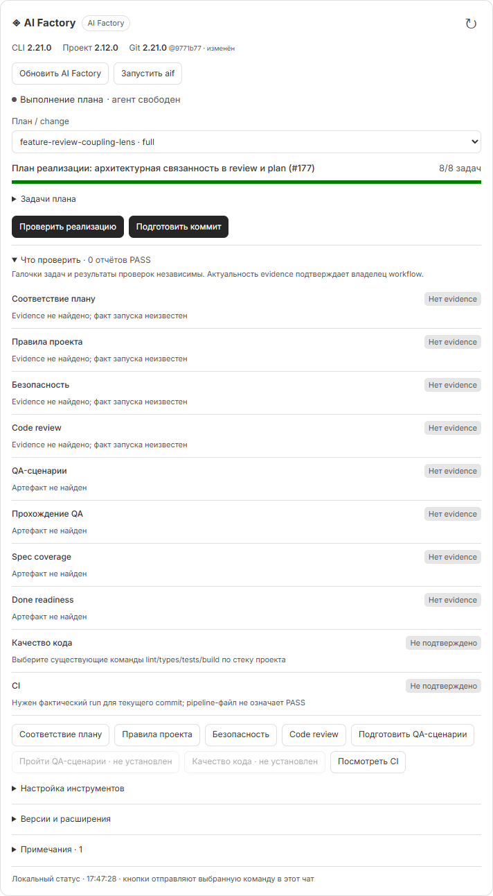
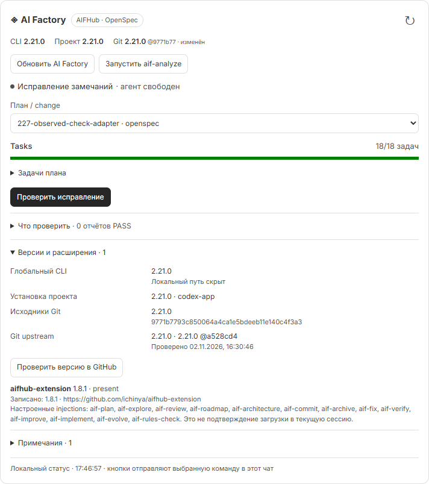

# Скриншоты BB AIF Helper

[Главная документация](../../README.md)

Кадры карточек workflow и верхнего меню сняты 2 ноября 2026 года в BB с плагином **0.1.3**; отдельная демонстрация предложений команд относится к **0.2.0**. Для публикации изолированы фактически отрисованные блоки интерфейса: окружающая переписка и посторонние вкладки скрыты, абсолютный путь к глобальной установке скрыт. Значения прогресса и результатов проверок не перерисованы. Workflow-команды при съёмке не запускались.

## Предложения команд над полем ввода — 0.2.0

Кадр ниже снят в настоящем BB с **0.2.0** на изолированной браузерной фикстуре: RPC предложений подставлял две команды из примера, а отправка команд была заблокирована. Это демонстрация расположения и крестиков, а не утверждение о текущем последнем ответе проекта. Удаление одной команды проверено без изменения данных BB или запуска агента.

## Верхнее меню и постоянная панель

Кнопка **AI Factory** находится справа в заголовке открытого чата. Она остаётся на месте при прокрутке переписки; на узком экране BB переносит её в меню заголовка.

Нажатие открывает панель справа с версиями, выбранным планом и действиями workflow. Переписка и названия посторонних вкладок скрыты для публикации; пустая область слева показывает расположение панели относительно чата.

## Прогресс плана и следующий шаг

AI Factory upstream: отмечены 8 из 8 задач, доступны проверка реализации и подготовка коммита. Выполнение задач не означает, что отдельные gates уже пройдены.

## Проверки и QA

Раскрытая секция **Что проверить** показывает verify, rules, security, review, QA-сценарии, прохождение QA, coverage, done readiness, качество и CI отдельно. Отсутствие evidence остаётся видимым даже при полностью отмеченном плане.

## AIFHub OpenSpec и версии расширений

Установленный `aifhub-extension` распознан, доступны **Запустить aif-analyze** и **Проверить исправление**. Кадр снят после исправления совместимости общей установки Codex в 0.1.3. Глобальный CLI, установка проекта, Git и upstream показаны раздельно; локальный путь скрыт.

