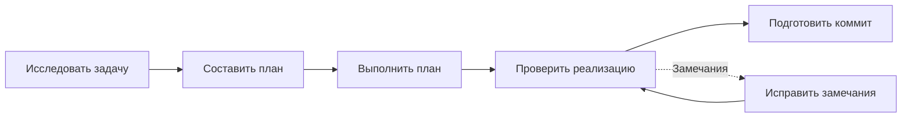
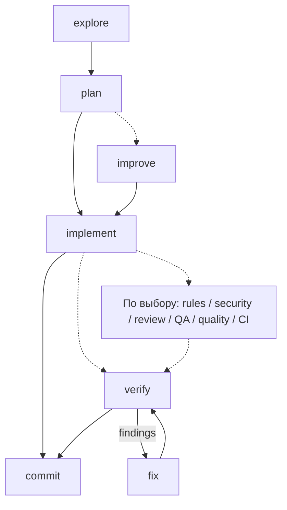
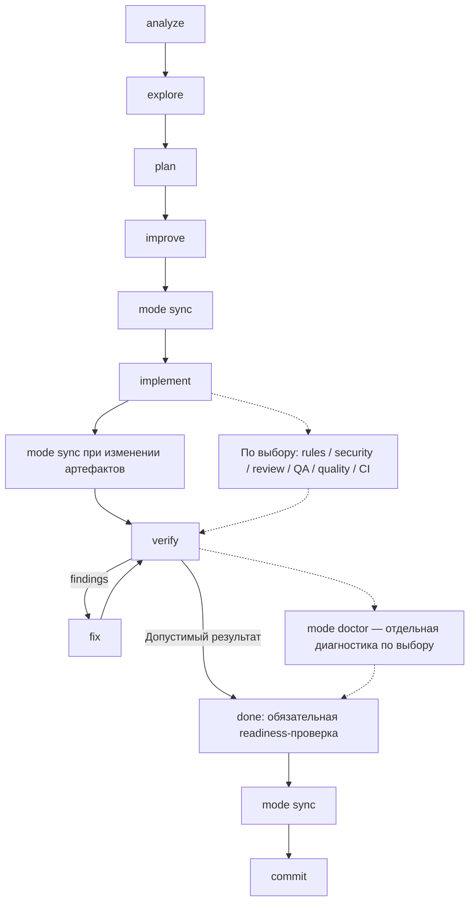

# Workflow и источники статуса

[README](../README.md) · [Настройки и CLI](reference.md)

Плагин предлагает переходы по установленным skills и фактическому формату артефактов. Правила проекта, контракты AI Factory/AIFHub, точные handoff и обязательные gates сохраняют приоритет. Кнопка ведёт к владельцу действия и не разрешает автоматически всю цепочку.

## Без установленного AI Factory

Если проект не инициализирован и профиль `none`, панель предлагает установку AI Factory и самостоятельный базовый workflow:

Это встроенные инструкции текущему агенту, а не вызовы неустановленных `aif-*`. Промпт исследования написан по принципам [upstream aif-explore](https://github.com/lee-to/ai-factory/blob/2.x/skills/aif-explore/SKILL.md): чтение действующего проекта, уточнение действительно неизвестных решений, сравнение вариантов, факты/риски/неизвестное и остановка до реализации. Промпт включён в пакет плагина; обращения к репозиторию или установка AI Factory при исследовании не требуются.

- **Исследовать задачу** — изучает код и требования, результат остаётся в чате.
- **Составить план** — создаёт `.bb-aif-helper/plans/<slug>.md`: цель, ограничения, `## Tasks` с нумерованными `- [ ]` задачами и `## Проверки`. Уточнение сохраняет уже выполненные пункты. Плагин сам не переключает режим планирования провайдера; используется файловый план с соблюдением ограничений текущего режима.
- **Выполнить/продолжить план** — предлагается для выбранного плана с задачами. Агент выполняет задачи и отмечает фактический прогресс; несколько планов требуют явного выбора, случайный файл не подставляется.
- **Проверить реализацию** — сопоставляет код с планом и запускает подходящие существующие проверки. Проблемы, NOTRUN и UNKNOWN сообщаются отдельно. Чекбоксы не означают PASS.
- **Подготовить коммит** — предлагается при незакоммиченных файлах Git, с просмотром diff и сохранением несвязанных изменений. Открытие панели не создаёт коммит.

Все шаги запускаются отдельным нажатием и сохраняют guards занятости, вопросов, повторной/неопределённой доставки и блокирующего gate. План и progress читает плагин; файлы и код по выбранному действию меняет агент. Встроенные шаги не устанавливают CLI/skills, не придумывают AI Factory QA reports и не выдают себя за AIFHub readiness.

**Установить AI Factory** — отдельная maintenance-кнопка. По нажатию агент проверяет имеющийся CLI и менеджер установки, при отсутствии CLI использует официальный способ установки (например, `npm install -g ai-factory`), затем инициализирует проект для поддерживаемого текущего runtime (`ai-factory init --agents codex-app --skills all` для Codex app). Linked/source установка и пользовательские файлы сохраняются; MCP и расширения не добавляются без отдельного выбора. Результат подтверждается metadata и существующими skills.

После успешной установки карточка освобождает только выбор базового плана и переключается на установленные действия. Markdown-файлы сохраняются; автоматического переноса в AI Factory/OpenSpec нет. Ошибочная существующая конфигурация с профилем `invalid` сохраняет ограниченный режим восстановления, а не обходится базовым flow.

## AI Factory upstream

В upstream improve/verify могут быть необязательными; требования проекта продолжают действовать. После explore доступны планирование и отдельный fix для исследованного дефекта. Сам `aif-fix` определяет допустимый режим fix-now/plan-first.

После подготовки плана предлагаются улучшение и выполнение. По мере реализации читаются чекбоксы. Завершённые задачи позволяют предложить verify или подготовку коммита, но не доказывают готовность к публикации.

Независимо от этапа, при подтверждённых незакоммиченных файлах текущего проекта первой предлагается **Подготовить коммит**. Это работает и без активного плана после архивации, и при нескольких кандидатах плана. Читается Git status рабочей папки, а не флаг изменения настроенного sourceRepo AI Factory: учитываются staged, unstaged и неигнорируемые untracked files. Чистый status или недоступный Git не создают это дополнительное предложение; существующие переходы к commit по этапу сохраняются. Некорректная конфигурация и отсутствие skill продолжают ограничивать доступность.

Кнопка не выбирает все грязные файлы в состав коммита. Владелец aif-commit сначала читает правила/status/diff и определяет scope; несвязанные изменения сохраняются. Перед отправкой запроса сервер перечитывает файлы, проверяет занятость, вопросы и последний блокирующий gate. Коммит и push не запускаются открытием панели.

## AIFHub classic и OpenSpec

Основные владельцы действий: explore → plan → improve → implement → verify → проверка готовности → done. Необходимые синхронизации артефактов и условия перехода определяет установленный AIFHub; это не полный перечень внутренних шагов skills.

Для OpenSpec полный маршрут и дополнительные ветви:

Пунктир обозначает необязательную ветвь навигации, а не отмену требований проекта. Выбирается одна или несколько подходящих проверок; они не запускаются пакетом или автоматически. Если политика требует конкретный gate, он обязателен перед завершением. Отдельный doctor необязателен, но readiness внутри done сохраняется. Sync-переходы показаны как контракт workflow; плагин пока не выделяет pre-implement sync отдельной основной кнопкой.

После plan предлагается improve. Новый баг без findings идёт через plan. При подтверждённых замечаниях используется fix → verify. Неблокирующий WARN сам по себе не создаёт лишний fix-loop.

После отчёта verify с PASS или неблокирующим WARN может быть предложен `aif-done`: финализатор заново проверяет готовность, обязательные evidence и актуальность. Это не утверждение, что done уже прошёл. Синхронизация и подготовка коммита выполняются отдельно.

В OpenSpec выбирается canonical `tasks.md` change; rules проверяются для выбранного change. Fast-план в проекте с AIFHub может делегироваться upstream. Выбор `aif-analyze` для настройки контекста всё равно определяется установленным расширением, независимо от профиля плана.

## Legacy ultra

Legacy ultra имеет отдельный маршрут с index ledger и receipt. Он не смешивается с classic-артефактами и обычной финализацией. Проверка receipt передаётся владельцу `aif-done`, который должен сохранить точный handoff к verify/archive. Наличие каталога само по себе не доказывает валидность ultra.

## Источники

- **CLI** — metadata пакета рядом с найденным в PATH shim; сам shim для версии не запускается.
- **Проект** — `.ai-factory.json`; неизвестная версия не подменяется глобальной.
- **Git** — настроенный `sourceRepo`, его HEAD и рабочее дерево.
- **GitHub** — upstream/ref по явному запросу, с SHA и временем проверки.
- **Расширения** — записи проекта и установленные manifests; extension JS при чтении не импортируется.
- **Навыки** — зарегистрированные базовые/custom skills с существующими `SKILL.md`.
- **Задачи** — чекбоксы canonical plan, `index.md` или OpenSpec `tasks.md`; примеры кода и комментарии не считаются задачами.
- **Занятость/вопросы** — текущее состояние чата BB.
- **Этап** — объявленное агентом или через `show` значение; не эвристика по тексту команд и времени файлов.

## Проверки и QA

Секция **Что проверить** разделяет verify, rules, security, review, QA-сценарии, результаты QA, coverage и done readiness. Quality/CI требуют фактических подходящих проекту проверок, а не файлов конфигурации.

### Дополнительные шаги flow

| Проверка | Когда полезна | Команда кнопки | Что подтверждает |
| --- | --- | --- | --- |
| Правила проекта | После изменений, перед verify/commit/done | `/aif-rules-check` | Соблюдение правил; в OpenSpec scope привязан к выбранному change |
| Безопасность | После изменений, затрагивающих безопасность, перед завершением | `/aif-security-checklist` | Результат security gate в проверенном scope |
| Code review | После реализации или исправлений | `/aif-review` | Findings и итог review |
| QA-сценарии | Когда понятны изменения и пользовательские сценарии | `/aif-qa` | Подготовку сценариев, без утверждения об их прохождении |
| Прохождение QA | После подготовки сценариев | `/aif-qa-check` | Фактические результаты выбранных сценариев |
| Качество кода | При подготовке проверок или перед завершением | `/aif-quality-setup audit` | Аудит существующих lint/types/tests/build; сам аудит не означает их успешный запуск |
| CI | Когда существует run для нужного commit | `/aif-chat ci` | Статус существующего run нужного SHA; без запуска/retry или создания pipeline |
| Конфигурация и артефакты | В OpenSpec перед реализацией или завершением, при проблемах режима | `/aif-mode doctor --change "<id>"` | Read-only диагностику выбранного change; без sync/init/исправлений |

В Codex кнопки используют `$` вместо `/`. Все эти действия находятся в секции **Что проверить**, рядом со своей строкой. Дополнительные строки помечены **по выбору**; распознанное требование политики заменяет эту подпись на **нужно для завершения**. Это не полный анализ всех правил проекта: отсутствие такой пометки не отменяет требований установленного skill или проекта.

Пропуск необязательной проверки сам по себе не создаёт FAIL и не останавливает основной маршрут. Уже полученный блокирующий FAIL, напротив, сохраняет силу: исправление → повторная проверка. Coverage и done readiness остаются отдельными артефактами/обязанностями владельцев; им не придумывается самостоятельная команда или необязательный статус.

Начиная с 0.3.1 завершённый `aif-gate-result` из истории чата показывается как **WARN/PASS/FAIL · из чата** с датой, номером сообщения, blockers и причиной рекомендации. Он привязывается к плану только по точному canonical path в `affected_files` либо предшествующем запросе запуска. Результаты разных gates сохраняются независимо: новый rules не стирает verify. Запись из чата и наличие файлового отчёта показаны отдельно; история не подтверждает актуальность результата для текущих файлов и не меняет готовность workflow автоматически.

Чтение ограничено последними 600 событиями завершения items/запросов запуска, страницами по 100, с кэшем 15 секунд и обновлением на границах работы агента. Найденные результаты сохраняются в хранилище плагина по чату, рабочей среде, хосту и корню проекта. Если старый gate находится за пределами окна и раньше не был обнаружен, он не будет отмечен. Неоднозначная привязка, prose PASS, вложенные tool messages и повреждённые gates не засчитываются.

- **Нет evidence** (`notrun`) — артефакт не найден; факт прежнего запуска неизвестен.
- **PASS в отчёте** (`reported-pass`) — валидный gate block содержит PASS; актуальность для текущих входных данных отдельно не подтверждена.
- **С замечаниями** (`warn`) — отчёт содержит WARN.
- **Ошибка** (`fail`) — отчёт содержит FAIL или распознанный блокирующий результат.
- **Не подтверждено** (`unknown`) — основания для результата недостаточны; например, файл есть, но валидного gate block нет.

Для gates читается последний валидный блок `aif-gate-result` нужного типа. Галочка плана, старый PASS, подготовленные QA-сценарии или pipeline не дают актуального зелёного результата.

**Качество кода** запрашивает read-only аудит существующих инструментов стека. Настройка проверок/CI вынесена отдельно. **Посмотреть CI** проверяет существующий run нужного SHA, без генерации pipeline и его запуска.

## Повторные проверки

Кнопки находятся прямо в строках проверок. Для verify/rules/security/review после живого завершения валидного gate плагин фиксирует состояние Git и прочитанных metadata выбранного плана. Пока оно совпадает с текущим, кнопка отключена с подписью **без изменений**. Это относится и к повторной команде из предложений, и к дублирующей кнопке verify над списком. После изменения файлов кнопки снова доступны; сервер сравнивает актуальное состояние непосредственно перед отправкой.

Отпечаток включает HEAD, branch, index, diff/status, установку/runtime, canonical plan, прочитанные metadata и байты неигнорируемых untracked files. Этап, часы и занятость чата не считаются изменением файлов. Неигнорируемые новые файлы ограничены 200 файлами, 1 MiB на файл и 32 MiB суммарно; Git output — 1 MiB. Другие игнорируемые файлы вне прочитанных metadata не входят в сравнение. Если Git/чтение недоступны, обнаружены submodules или превышен лимит, повтор остаётся доступным.

Состояние фиксируется только на событии завершения текущего ответа и связывается с конкретным gate/планом/средой. Старый результат, загруженный из истории, не получает отпечаток сегодняшних файлов. Перезагрузка не меняет сохранённую привязку. Неизвестные результаты, QA/quality/CI без подходящего структурированного gate не блокируются этим правилом. Действия coverage/readiness не придумываются при отсутствии подходящего owner-действия.

Подпись **без изменений** означает совпадение с состоянием при фиксации результата, а не доказательство свежего PASS. При необходимости пользователь может отдельно запросить повторную проверку в чате.

## Кэш и обновление

Снимки файлов сохраняются в SQLite-базе самого плагина и в памяти. Ключ включает рабочую среду, корень/хост, цель, runtime и настройки источников. Разные этапы карточек используют одно чтение файлов, но получают свои действия и phase; состояние чата, вопросы и gate-история добавляются отдельно. Параллельные запросы к одному снимку объединяются.

Обычное чтение использует память до 60 секунд. После истечения срока карточка сразу получает предыдущие данные, пока идёт одно фоновое обновление. После reload сохранённый снимок также показывается сразу и обязательно сверяется в фоне. Максимум — 100 снимков по 1 MiB; снимки старше 24 часов требуют полного чтения. Время внизу относится к сбору данных, а не к моменту открытия карточки. Фоновая ошибка оставляет сохранённые данные с предупреждением и 15-секундной задержкой перед повтором.

**↻** отправляет `force: true` и запускает новое чтение без кэша. То же правило действует для CLI/agent status и перед отправкой workflow-команды; ошибка принудительного чтения не заменяется кэшированным успехом. Окончание работы агента помечает снимки среды для обновления. Занятость и вопросы читаются при каждом запросе. Автоматического GitHub version check, запуска модели или workflow для обновления кэша нет.

История gates сверяется не чаще раза в минуту в обычном отображении и сразу при принудительной проверке/границе workflow. Сохранённые результаты доступны до завершения сверки. Старые завершения фонового запроса не должны перезаписать более свежие данные после invalidation или reload.

## Версии и размещение обновления

Для версий CLI и настроенного Git checkout действует отдельный кэш 24 часа. Обычный refresh/force перечитывает задачи, проверки, конфигурацию и установленные extension manifests, но не запускает заново CLI/source version probes. В разделе версий показано время снимка. Прочитанные для workflow metadata дают текущую проектную и установленную версию расширений без внешних запросов. При явном обновлении через maintenance локальный version-кэш инвалидируется; завершающий status показывает новый CLI/checkout.

Проверка GitHub запускается по соответствующей кнопке или `check-updates`. Сохранённая попытка ограничивает запросы одного host/repo/ref одним разом за 24 часа. Попытка резервируется до обращения к хосту, поэтому ошибки, параллельные запросы, force и reload не обходят ограничение. Кнопка показывает следующую доступную дату. Обычное чтение панели не начинает сетевую проверку расширений или GitHub.

Если CLI и версия проекта известны и совпадают со всеми известными Git/worktree/upstream версиями, кнопка обновления AI Factory остаётся доступной внутри «Версии и расширения». При неизвестной локальной версии или расхождении она видна наверху. Кнопка расширений перемещается внутрь только при совпадающем ядре и здоровых extensions с одинаковыми recorded/installed версиями. Setup-команда находится наверху до начала выполнения плана, затем под «Настройка контекста проекта». Это размещение по имеющимся версиям, а не утверждение о проверенном отсутствии новых релизов при неизвестном upstream.

## Границы автоматизации

Открытие панели и опрос статуса не запускают навыки, тесты, обновления или модель. Явная проверка версии обращается к GitHub. После нажатия workflow-кнопки запрос исполняет текущий агент с обычными полномочиями BB и лимитами выбранного провайдера.

Плагин не проставляет задачи, не пишет evidence, не архивирует планы и не публикует изменения самостоятельно. Недостающие receipts, legacy-структуры и противоречивые metadata показываются как ограничения. Автоматическая миграция отсутствует.
