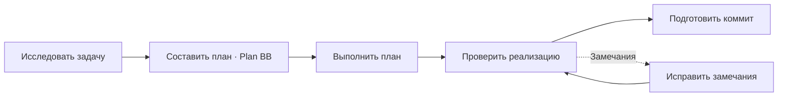
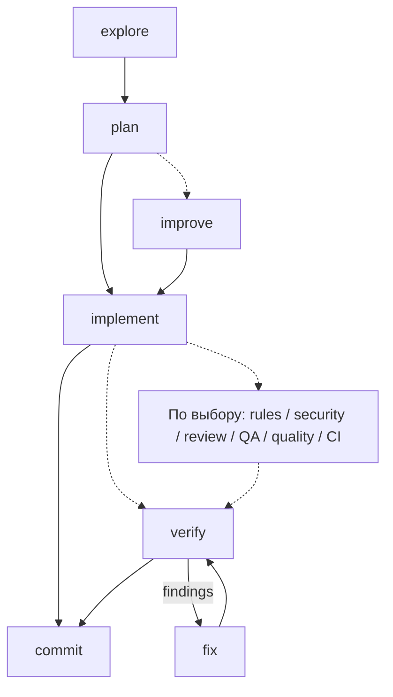
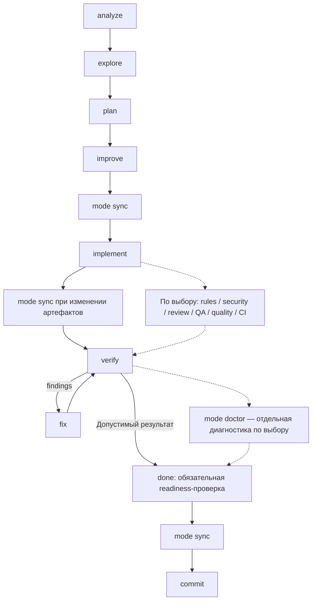

# Workflow и источники статуса

[README](../README.md) · [Настройки и CLI](reference.md)

[Совместимость с AI Factory 2.22](ai-factory-2.22.md): настройки коммитов/TDD, общие skills, fix defaults, coupling, worktree и opt-in completion hook.

Плагин предлагает переходы по установленным skills и фактическому формату артефактов. Правила проекта, контракты AI Factory/AIFHub, точные handoff и обязательные gates сохраняют приоритет. Кнопка ведёт к владельцу действия и не разрешает автоматически всю цепочку.

## Вкладка: «Навигация» и «Настройки»

Постоянная вкладка AI Factory разделена переключателем **Навигация | Настройки** в закреплённой шапке; выбор запоминается для чата на сессию браузера (sessionStorage). На узкой панели (ширина контейнера меньше 448 px) переключатель переносится второй строкой шапки на всю ширину двумя равными половинами. «Навигация» — текущая работа: предупреждение «Проект не подготовлен к AI Factory» с кнопкой **Подготовить** (переход в «Настройки» к блоку подготовки), пока не выполнены основные шаги `install`, `context`, `architecture` (`readinessCoreComplete`), «Сейчас», «В работе» (дочерние треды исполнителей и разведчиков — только когда они есть) и «Что проверить». «Настройки» — то, что задаётся один раз: «Подготовка проекта» (первой, с рамкой акцентного цвета, пока не выполнены основные шаги), «Исполнители», «Оценка кнопок» (строка «Gemini Decisions» с подписью), «Модели по умолчанию для новых проектов», «Настройка инструментов», «Другие команды» и «Версии и расширения» со строкой версий CLI, проекта и Git. Точка на «Настройки» означает ошибку конфигурации, доступное обновление или невыполненные основные шаги подготовки. Карточки в переписке без переключателя и не изменились.

Секции панели собраны группированным списком: мелкий серый заголовок группы над блоком без рамки, строки разделены линиями; вложенные рамки внутри секций убраны. Этот стиль действует только во вкладке — карточки в сообщениях сохраняют прежнюю вёрстку. В «Подготовке проекта» справа в строке стоят кнопки **Запустить** (у первого невыполненного шага — залитая) и, у необязательных шагов, **Пропустить** / **Вернуть**; нажатие на название (или «?») раскрывает только описание шага. В «Исполнителях» вся строка роли — кнопка «Изменить»: название, модель с уровнем рассуждения второй строкой и «›» справа; «?» стоит сразу после названия роли и не открывает редактор.

«Исполнители» — четыре строки (Код, Разведчик 1, 2, 3); вся строка — кнопка, раскрывающая редактор «Этот агент / Другая модель» с пояснениями под «?». «Модели по умолчанию для новых проектов» хранятся в `bb.storage.kv` (`delegation-defaults`) — общие для всех проектов и машин этого BB; кнопки «Взять из этого проекта», «Применить к этому проекту», «Очистить». В проекте с настроенным AI Factory, где все четыре роли — «Этот агент», умолчания применяются один раз теми же файлами, что ручное сохранение (`.ai-factory.json` → `phases.implement` и блоки skill-context); проект помечается `delegation-defaults-applied:<hostId>:<path>`, повторного применения нет, ручное сохранение любой роли тоже ставит отметку, чужой `phases.implement` не трогается — применяются только разведчики. Автоприменение оставляет некоммиченные изменения в репозитории проекта.

## Режим AI Factory в поле ввода

Кнопка со значком «завод» в поле ввода (во включённом состоянии — оранжевая заливка с белым значком, не цвета темы) (области `new-thread` и `thread`) включает режим для проекта. Состояние хранится в SQLite плагина (`project_modes`), чтение синхронное — его выполняет `bb.agents.configure` на каждом `thread.start`/`turn.submit`.

- **Инструкции.** При включённом режиме и `enabled` плагина `configure` добавляет агенту текст `aifModeInstructions()`: читать `.ai-factory/DESCRIPTION.md` и `ARCHITECTURE.md` (пути — из `config.yaml`), вести работу `/aif-plan` → `/aif-implement` → `/aif-verify` → `/aif-commit` (`/aif-fix` для багов), соблюдать `.ai-factory/skill-context/`, вызывать `aif_chat_status` на границах этапов. Дочерним тредам (`parentThreadId !== null`) инструкции не добавляются — это исполнители и разведчики со своим брифом.
- **Ограничение F2.** Изменённые инструкции не попадают в уже запущенную сессию ни у одного провайдера: они применяются при следующей сборке сессии (новый тред, возобновление после рестарта демона). Поэтому в идущий чат режим передаётся только упоминанием `@AI Factory`, набранным вручную (см. ниже).
- **Упоминание.** Провайдер упоминаний `aif-mode` (`@AI Factory`, поиск по `aif`/`фабрика`/`режим`) при отправке отдаёт агенту текст режима как `agent-only` контекст (F4). Плагин не вставляет его в черновик сам: автовставка после включения режима и после `thread/compacted` убрана в 0.24.2 по просьбе владельца, вместе с флагом `kv aif-pill:<threadId>`, RPC `ackAifPill` и наблюдателем `experimental_thread.events`. Поэтому в идущий чат и после компакта у ACP-провайдеров (они передают инструкции текстом первого промпта и могут сжать их) режим передаётся только упоминанием, набранным вручную. Выключение режима убирает упоминание из черновика.
- **Проект без AI Factory.** В области `thread` при `configured === false` кнопка не включает режим, а открывает вкладку AI Factory. В `new-thread` окружения ещё нет — проверка не делается; без выбранного проекта кнопка неактивна.
- **Подсказки.** Если в последнем ответе агента нет команд AI Factory и ответ пуст без gate/ошибки, при включённом режиме показываются до 3 доступных действий группы `next` с причиной «Следующий шаг». Подсказки из ответа агента приоритетнее.
- **Модель исполнителя.** Для каждого дочернего треда читаются последнее `client/turn/requested.data.execution` (запрошенные модель и уровень — F7) и `provider/modelFallback` после него. Подпись «Провайдер · модель · уровень · статус»; «⚠ Подмена: A → B (причина)» — только при событии fallback, которое пишет один Claude Code (F8): у Codex и ACP тихая подмена провайдера BB не видит. «⚠ Ожидалась модель …» — когда тред `AIF · …` или `AIF research · …` запущен не на модели, выбранной в «Исполнителях». Результат кэшируется по `childId + updatedAt`; ошибки чтения событий обнуляют поля без падения панели.

## Подсказки команд и оценка кнопок

Чипы над полем ввода собираются из последнего ответа агента: имена `$aif…`/`/aif…` и команды, написанные целиком в inline code. Команда из code span сохраняет аргументы (одна строка, до 300 символов); из обычного текста берётся только имя — аргументы отбрасываются, кроме фиксированной `aif-mode sync`. На одну команду — один чип: вариант с аргументами важнее голого. Чипы неустановленных skills не показываются, кроме `suggested_next` из gate — он авторитетен и остаётся тусклым с причиной.

Нажатие на чип с аргументами при пустом поле отправляет команду сразу; голые `aif-explore`/`aif-plan`/`aif-fix` ждут тему. Если такую команду назвал `suggested_next` gate, её тема берётся из `suggested_next.reason` (до 500 символов), и чип отправляется сразу; режим AI Factory просит агента писать эти команды сразу с темой. При непустом поле команда с аргументами встаёт первой строкой (заменяя её, если она начинается с команды) без отправки; пилюля режима AI Factory в черновик-команду не добавляется — BB передал бы её текст skill как аргументы.

**Оценка кнопок** выключена по умолчанию и включается в «Настройках» → «Оценка кнопок». При двух и более доступных командах сервер один раз на ответ агента (ключ — `sourceKey` + набор id, результат кэшируется) отправляет в Google Gemini Decisions API (`gemini-decision-1`) запрос с вопросом `choice`: в `input` идёт последний ответ агента, обрезанный до 20 000 символов, в `criteria` — id и текст команд-кандидатов. Ответ разбирается zod-схемой, вероятности проставляются чипам; кнопки сортируются по убыванию, у вероятнейшей — акцентная рамка. Таймаут запроса — 15 с, параллельных запросов на один ключ нет; ошибка кэшируется без повторов для того же набора, причина видна в «Настройках».

Ключ API выбирается источником «Из Env Catalog» или «Ввести вручную». Из каталога хранится только имя записи; значение читается перед каждым запросом через RPC `env_get_value` плагина env-catalog (таймаут 5 с), список имён — через `env_list`. Если env-catalog не установлен, остаётся только ручной ввод — секретная настройка плагина `decisionsKey` (файл 0600, значение никогда не отправляется во вкладку). Чтения env-catalog пишутся в журнал aif-chat только по имени ключа; значение ключа и текст ответа в журнал не попадают.

## Параллельное выполнение задач плана

Опциональный режим делегирования кода: у роли **Код** при «Другая модель» в «Исполнителях» появляется переключатель **Параллельно** (Выкл · 2 · 3 · 4). Хранится как query-параметр `parallel=2..4` в `phases.implement.model` рядом с `reasoning`/`tier`, поэтому переживает `ai-factory update`; при «Этот агент» и у ролей разведки параметра нет. Параллельный расчёт работает только для AI Factory-планов — встроенный flow `.bb-aif-helper/plans/` и OpenSpec change идут последовательно.

**Группы решает координатор, как в AI Factory.** Плагин план не разбирает. Управляемый блок в `.ai-factory/skill-context/aif-implement/SKILL.md` переносит алгоритм агента AI Factory `implement-coordinator` (`subagents/claude/agents/implement-coordinator.md`): модель читает план, берёт у задач номер, фазу и `(depends on X, Y)`; задачи одной фазы без явных зависимостей независимы, поздняя фаза зависит от всех ранних. Задачи, которые явно правят один файл, координатор разводит по разным слоям. Перед первым исполнителем он пишет в план `<!-- parallel: tasks N, M -->` над каждой группой, задачу в работе отмечает `- [~] … <!-- in-progress -->`, выполненную — `[x]`, а упавшую после трёх попыток — `- [!] … <!-- failed: причина -->`. Слой — до N задач, остальные в следующем батче. Задачи коммита, контрольные точки `## Commit Plan`, push и выкатку выполняет только координатор. Карточка плана считает `[~]` и `[!]` невыполненными задачами. Разбор текста регулярными выражениями (бывший `parallel-plan.ts` и команда `groups`) удалён: свободный Markdown ломал его на обычных фразах, а в самом AI Factory план тоже читает модель.

**Исполнитель** работает по контракту `implement-worker`: одна задача, без правки плана, коммитов, навыков и других агентов; при противоречии требованиям ничего не меняет и отвечает `handoff_outcome: blocked_external`; в отчёте — список изменённых файлов, его координатор сверяет с результатом `bring-back`.

**Сбои** координатор разбирает сам: упавшая проверка — исправить или отправить исполнителю точную ошибку (`bb thread tell`); конфликт двух исполнителей — оставить перенесённое и переделать задачу после слоя свежим исполнителем, чья копия уже содержит перенесённое; сбой BB — один повтор, затем задача одним исполнителем. Одна и та же причина три раза — `[!]` и вопрос владельцу. Сразу к владельцу — `blocked_external`, правки за пределами задачи, пересекающиеся с чужими, секреты, рабочий сервер и удаление данных. Итог — `Status: complete|partial|failed|blocked_external`.

**Как идёт выполнение.** Все шаги с git и запуском исполнителей делают команды плагина (`parallel-git.ts` на машине папки, `server.ts` в BB): координатор не вставляет пути, JSON и вывод `git status` в оболочку, поэтому пробелы, кириллица, `[]`, кавычки, Windows-пути и PowerShell не ломают ни один шаг.

1. **Запуск исполнителя**: `bb plugin run aif-chat spawn-worker --target <имя плана> --task <id> --brief '<файл задания>' --json` (имя плана — только подпись треда: имя файла плана без `.md`, где всё, кроме латинских букв, цифр, `-`, `_` и `.`, заменено на `-`, а `-` и `.` в начале убраны (`plan`, если ничего не осталось), поэтому кавычки не нужны и имя не читается как ключ; номер задачи — `3` или вложенный `1.2`; имя файла задания — только буквы, цифры, `-`, `_` и `.`, в папке без `'` в пути; все пути в командах инструкции стоят в одинарных кавычках, которые в bash и PowerShell сохраняют `$`, пробелы и `\` как есть). Плагин читает задание на машине папки, берёт модель из настроек роли **Код** и запускает дочерний тред `AIF · <план> · <id>` через `bb.sdk.threads.spawn` в среде провайдера `aif-chat-worktree` (`basePath`, `seed: true`, имя `<план>-<id>-<случайный суффикс>` — повтор никогда не упирается в ещё не удалённую копию). Провайдер (`worktree-provider.ts`) на машине папки находит её git-репозиторий, делает `git worktree add --detach` всего репозитория в `~/.bb-aif-helper/worktrees/<репозиторий>-<хеш>/<имя>`, и переносит в копию незакоммиченную работу координатора: дерево собирается во временном индексе — копии индекса координатора, поэтому застейдженное вручную (`add -f`, переименование только регистром) тоже попадает, — плюс `add -A` (новые игнорируемые файлы не попадают), в копии ложится `read-tree --reset -u`: индекс копии равен этому дереву, и работа координатора видна в ней как застейдженные изменения. Индекс и файлы координатора не меняются. Поэтому следующий слой видит результаты прошлых без коммитов, и история остаётся такой, как задумал план: коммитит только координатор и только там, где велит план. Исполнитель стартует в той же подпапке внутри копии; раздел, который есть только среди незакоммиченных файлов, тоже работает. Поэтому режим работает и там, где папка — раздел внутри большого репозитория, а корень проекта BB не git-репозиторий: штатный `--new-environment worktree` в таком проекте отвечает `HTTP 409 … no usable git branch`. Неотслеживаемые игнорируемые файлы вроде `node_modules/` не копируются — исполнитель ставит зависимости сам и не коммитит; нужный ему такой файл координатор называет в задании абсолютным путём, только для чтения.
2. **Ожидание исполнителя**: `bb plugin run aif-chat wait-worker --worker <id> --json`, затем снова с `--after <seq>` из прошлого ответа (`worker-wait.ts`). Плагин принимает любой дочерний тред этого чата (параллельного исполнителя, исполнителя одиночного режима, исследователя) и отвечает не дольше чем через 90 секунд: `state` (`working`, `idle`, `stopped`, `failed`), `seq` — номер последнего события, `resumed`, `quietForMs` — сколько в треде не было событий — и `output` — последний отчёт. `stopped` — только явная ручная остановка, когда BB больше нечего запускать; другой обрыв хода (`provider-turn-idle`, перезапуск хоста, отмена хода самим провайдером) — `failed`, его координатор повторяет; любое сообщение в очереди, которое BB ещё может запустить, — `working`. Курсор `seq` снимается до чтения состояния, а следующий вызов смотрит журнал событий после него, поэтому возврат к работе, завершение или сбой между двумя вызовами не теряются. Это важно для Antigravity: он завершает ход, пока тесты идут в фоне, и потом продолжает сам (у одной задачи живого прогона 5 таких пауз), а BB его фоновые команды не видит. Свободный исполнитель с пустым или промежуточным отчётом («жду тесты») ещё работает; координатор вызывает команду снова. Если исполнитель не закончил (`working` или `idle` с таким отчётом), а в треде 8 минут нет событий (`quietForMs` больше 480000), координатор исполнителю ничего не шлёт и спрашивает владельца: сам он исполнителя не будит, потому что `bb thread stop` свободного треда не оставляет следа и остановленного вручную исполнителя не отличить от медленного. Перед тем как перезапустить задачу или сделать её самому, координатор останавливает и архивирует старого исполнителя, чтобы тот потом не записал файлы. Известные ограничения (ревью `ce6fe14`, оставлены сознательно): состояние восстанавливается по событиям и очереди треда снаружи BB, поэтому сообщение, отправленное уже закончившему исполнителю, может на миг пропасть из очереди и его отчёт будет принят за прошлый; уточнение, исчерпавшее повторы после успешного хода, тоже не видно. Координатор таких сообщений исполнителю не шлёт — перезапуск задачи заводит нового исполнителя, — а любой незаконченный случай ограничен 8 минутами тишины. Точный признак «тред затих, очередь пуста» может дать только ядро BB.
3. **Возврат результата** по одному исполнителю: `bb plugin run aif-chat bring-back --worker <id> --json`. Плагин проверяет, что это исполнитель этого чата в копии AI Factory на той же машине и того же репозитория, собирает в копии патч во временном индексе от дерева засева или прошлого переноса (`read-tree`, `add -A`: файл координатора, который исполнитель добавил в `.gitignore`, и не развёрнутый в копии подмодуль не считаются его правкой; `diff --cached --binary --no-color --no-relative --no-renames --no-ext-diff --no-textconv --src-prefix=a/ --dst-prefix=b/`; копии исполнителей блоки плагина не переписывают, так что в патче только правки исполнителя), затем `git apply --check` и `git apply` в основной папке. Переносится только то, что исполнитель изменил после прошлого переноса (дерево последнего переноса — а до первого переноса дерево засева — хранится в собственной git-папке копии, поэтому работа координатора не возвращается как правка исполнителя), поэтому доработку того же исполнителя можно перенести ещё раз. Если запись оборвалась на середине (файл заблокирован или папка только для чтения), уже записанные файлы возвращаются как были, и повтор — обычный перенос; `partial: true` значит, что какие-то файлы вернуть не удалось. `git apply` без `--3way` не трогает индекс и отклоняет неподходящий патч до записи файлов: при отказе (`{ applied: false, error }`) откатывать нечего, результаты прошлых задач целы, неразрешённых файлов (`UU`) не бывает. Обычно это значит, что другая задача слоя изменила те же строки: координатор переделывает её после слоя. Подмодуль — другой репозиторий: если исполнитель передвинул его или изменил файлы внутри подмодуля — отслеживаемые или новые, которые git подмодуля не игнорирует, в развёрнутом подмодуле на любой глубине (каждый сравнивается со своим HEAD, так что настройки `status.*` и `ignore = all` правку не скрывают), или любые файлы в папке не развёрнутого подмодуля, — перенос отказывает с их списком, ничего не изменив. В папке не развёрнутого в копии подмодуля перенести патчем нельзя ничего, поэтому любой файл в ней, игнорируемый или нет, останавливает перенос: отказ можно исправить, а молча потерянный файл — нет. Папка подмодуля, заменённая ссылкой или файлом, — тоже изменение, по ссылкам плагин не ходит, а папку, которую нельзя прочитать, не пропускает молча. Собранный `dist/` в развёрнутом подмодуле блокирует перенос, только если git подмодуля его не игнорирует. В обоих случаях исполнитель удаляет такие файлы в своей копии, и перенос повторяется. Переименование только регистром на Windows и macOS git не видит и не переносит: такую задачу координатор делает сам. Пустой патч (`empty: true`) — исполнитель ничего не изменил: задача выполнена, только если это проверка или её правки уже перенесены (продолжение после обрыва) и проверка задачи проходит в рабочей папке; иначе не выполнена.

Тесты `tests/worktree.test.ts` (переименование, удаление, `todo[1].txt` рядом с `todo1.txt`, кириллица, кавычки, раздел внутри репозитория, конфликт патча) и `tests/parallel-cli.test.ts` (Windows-путь с пробелом и кириллицей доходит до BB как есть) гоняются в CI на Ubuntu, Windows и macOS. Задача отмечается выполненной только после перенесённого и проверенного результата; тред исполнителя архивируется, а копию BB удаляет сам через 5 минут (провайдер вызывает `git worktree remove --force` из основного репозитория — на Windows git, запущенный изнутри копии, не может её удалить — и удаляет только папки внутри `~/.bb-aif-helper/worktrees/`). Промежуточных коммитов параллельный режим не делает.

В «В работе» дочерний тред, чья среда — отдельная worktree-копия, помечен бейджем **«отдельная копия»**.

**Когда не ускоряет.** Задачи, зависящие друг от друга, правящие один файл или короткие, идут по очереди; каждый слой всё равно стоит spawn + ожидание + перенос патча, а слой из одной задачи работает по обычному одноисполнительному сценарию.

**Правило для планировщика.** При включённом параллельном режиме плагин записывает управляемый блок в `.ai-factory/skill-context/aif-plan/SKILL.md` (между маркерами `bb-aif-helper:plan`): формат задач AI Factory — `(depends on 1, 2)` в конце строки задачи и подсказка `Files:` у каждой задачи; задачи с общими файлами — зависимые или объединённые, коммит и выкатка — последние. При выключении переключателя блок удаляется.

## Ожидание подтверждения

После вызова `aif-improve` для выбранного плана агент может показать diff и спросить «Применить этот diff к design.md и tasks.md?». Тогда над вводом появляется **Применить всё**. Само обнаружение предложения ничего не применяет: только нажатие отправляет одно видимое согласие на предложенные правки этого плана. Выполнение плана не запускается, повторный improve не вызывается. Кнопку можно убрать крестиком, сохранив черновик сообщения.

Кнопка привязана к последнему завершённому ответу основного агента и предшествующему запуску improve того же плана. Цитаты, примеры, дочерние агенты и обычное согласование объёма её не создают. Новый пользовательский запрос или другой ответ снимает предложение; одинаковый текст после нового improve считается отдельным предложением. Перед отправкой проверяются свежие файлы/выбор, история, занятость и отсутствие native-форм BB. На открытые native-вопросы нужно ответить в их форме. Только эта кнопка может подтвердить текстовый запрос применения; остальные действия workflow сохраняют блокировку ожидания ответа.

В ленте остаётся только последняя карточка, выданная инструментом статуса или CLI `show`. При следующем выводе предыдущая скрывается и перестаёт перечитывать статус проекта. Выбор последней карточки сохраняется после перезагрузки плагина и действует отдельно для каждого чата. Старые карточки без идентификатора тоже скрыты; текст ответов, gate-данные и постоянная панель сохраняются. Это очистка отображения, без удаления истории сообщений.

После предварительного исследования агент может остановиться на вопросе «Подтверждаете такой объём?». Пока BB хранит открытый вопрос или последний ответ агента явно просит подтверждение, карточки workflow в ленте скрыты. Постоянная панель остаётся доступна: показывает прогресс и ожидание ответа, но не запускает действия.

Для обычного текста проверяется последний ответ основного агента после последнего пользовательского запроса; цитаты, блоки кода и ответы дочерних агентов не создают ожидание. Это эвристика для явных запросов подтверждения, а не универсальное распознавание всех вопросов и не доказательство разрешения. Новое сообщение пользователя снимает старое ожидание, включая отказ и уточнение. Никакой шаг при этом автоматически не выполняется.

Наличие или отсутствие кнопок не заменяет действующие разрешения. При недоступности истории повторный запуск блокируется до обновления статуса. Агенту предписано не добавлять карточку к вопросу; инструмент при обнаруженном ожидании возвращает пустой `previewDirective` и `awaitingUser: true`.

## Без установленного AI Factory

Если проект не инициализирован и профиль `none`, панель предлагает установку AI Factory и самостоятельный базовый workflow:

Если ранее выбранный файл плана исчез, helper сбрасывает устаревшую привязку и сохраняет доступ к исследованию и составлению нового плана. Другой файл автоматически не подставляется. Это восстановление навигации без изменения проекта; повреждённая конфигурация и небезопасные пути продолжают блокировать workflow.

Это встроенные инструкции текущему агенту, а не вызовы неустановленных `aif-*`. Промпт исследования написан по принципам [upstream aif-explore](https://github.com/lee-to/ai-factory/blob/2.x/skills/aif-explore/SKILL.md): чтение действующего проекта, уточнение действительно неизвестных решений, сравнение вариантов, факты/риски/неизвестное и остановка до реализации. Промпт включён в пакет плагина; обращения к репозиторию или установка AI Factory при исследовании не требуются.

- **Исследовать задачу** — открывает поле «Что исследовать?». Укажите вопрос, проблему или ссылку на задачу (до 4000 символов), затем нажмите «Начать исследование». Пустое описание не отправляется; «Отмена» закрывает форму без запуска. Описание видно в сообщении агенту; исследование изучает код и требования без изменения файлов, результат остаётся в чате. Обновление статуса и ошибка отправки сохраняют черновик.
- **Составить план / Уточнить план** — отправляет встроенную команду `/plan` с нативной меткой BB, как пункт Plan в меню ввода. Агент генерирует Markdown-документ в блоке `aif-plan`: цель, ограничения, `## Tasks` с чекбоксами, проверки и критерии готовности. Плагин оформляет его как документ. Только после завершения генерации документ сохраняется в `.bb/aif-helper/plans/`, а форма действий появляется под текстом и ссылкой на файл. Сам агент соблюдает ограничения Plan и не пишет файлы проекта. Если провайдер не объявляет поддержку Plan, запрос не отправляется. Настройки разрешений и провайдер не меняются.
- **Выполнить/продолжить план** — предлагается для выбранного плана с задачами. Агент выполняет задачи и отмечает фактический прогресс; несколько планов требуют явного выбора, случайный файл не подставляется.
- **Проверить реализацию** — сопоставляет код с планом и запускает подходящие существующие проверки. Проблемы, NOTRUN и UNKNOWN сообщаются отдельно. Чекбоксы не означают PASS.
- **Подготовить коммит** — предлагается при незакоммиченных файлах Git, с просмотром diff и сохранением несвязанных изменений. Открытие панели не создаёт коммит.

Когда все задачи выбранного базового плана отмечены, отдельно доступна **Исследовать новую задачу**. Кнопка открывает то же поле «Что исследовать?»; отмена и пустое описание ничего не переключают. После успешной отправки начинается отдельное исследование в этом же чате: старый план остаётся в списке, но снимается с выбора, этап меняется на «Исследование». Состояние сохраняется после перезагрузки; предыдущий план не подставляется обратно автоматически. Его можно снова выбрать в списке. Выполнение всех чекбоксов даёт навигацию к новой задаче, но не означает PASS проверок и не отменяет подготовку коммита.

В списке показаны заголовки планов и «выполнено N из M». Базовый план скрывается по умолчанию, когда все его пункты выполнены (M > 0). Отметка проверки для скрытия не требуется. **Показать завершённые (N)** возвращает такие планы в список без изменения файлов. Если снять галочку задачи, план снова виден. Удаления или перемещения нет; скрытие не означает PASS проверок.

Classic-планы скрываются по явному `status: done` в соседнем `<plan-id>/status.yaml`, когда `plan_id` и имеющиеся ссылки `plan_file`/`artifacts.plan` соответствуют файлу плана. Полные галочки без этого статуса не скрывают classic-план. Переключатель возвращает закрытые планы с пометкой «закрыт»; повторное открытие статуса возвращает их в обычный список. Закрытый план не выбирается автоматически по ветке. Ошибочные, отсутствующие или чужие метаданные не считаются закрытием, а закрытие не подтверждает актуальный QA/CI PASS.

После фактического PASS всех обязательных проверок владелец проверки вызывает `bb plugin run aif-chat mark-verified --target <путь>`. Команда добавляет в начало файла `<!-- bb-aif-plan-verified: sha256=<хеш> -->`; хеш относится к содержимому плана без этой строки. Команда сама не запускает тесты и не доказывает PASS реализации. Изменение текста/галочек делает отметку неактуальной; её статус независим от фильтра завершённых планов. Отметка не записывается при генерации, NOTRUN/UNKNOWN или замечаниях. Для AI Factory/OpenSpec применяется их собственный lifecycle; завершённые задачи сами по себе не скрывают их артефакты.

Сохраняется только полный ответ основного агента после встроенной команды Plan, привязанный к версии и рабочей папке. Во время генерации, при оборванном блоке, новом запросе или ошибке записи форма выполнения не появляется. Предыдущая карточка скрывается при новом планировании и не превращается в форму над новым документом. Сохранение идемпотентно и не перезаписывает уже отмеченные пользователем задачи. Старый формат `<proposed_plan>` остаётся читаемым; последний такой ответ можно сохранить командой `bb plugin run aif-chat save-plan --thread <id>`. Нативные формы провайдера и обязательные gates сохраняются.

Все шаги запускаются отдельным нажатием и сохраняют guards занятости, вопросов, повторной/неопределённой доставки и блокирующего gate. Файловые планы с `## Tasks` и чекбоксами читаются из `.bb/aif-helper/plans/<slug>.md`; старый путь `.bb-aif-helper/plans/<slug>.md` остаётся совместимым без автоматического переноса: панель читает их задачи и предлагает выполнение, проверку и уточнение. Нативные планы показываются средствами BB; их прогресс не подменяется файловыми чекбоксами плагина. Встроенные шаги не устанавливают CLI/skills, не придумывают AI Factory QA reports и не выдают себя за AIFHub readiness.

Кнопка **Установить AI Factory** находится в разделе **Подготовка проекта**. По нажатию агент проверяет имеющийся CLI и менеджер установки, при отсутствии CLI использует официальный способ установки (например, `npm install -g ai-factory`), затем инициализирует проект для поддерживаемого текущего runtime (`ai-factory init --agents codex-app --skills all` для Codex app). Linked/source установка и пользовательские файлы сохраняются; MCP и расширения не добавляются без отдельного выбора. Результат подтверждается metadata и существующими skills.

После успешной установки карточка освобождает только выбор базового плана и переключается на установленные действия. Markdown-файлы сохраняются; автоматического переноса в AI Factory/OpenSpec нет. Ошибочная существующая конфигурация с профилем `invalid` сохраняет ограниченный режим восстановления, а не обходится базовым flow.

## AI Factory upstream

В upstream improve/verify могут быть необязательными; требования проекта продолжают действовать. После explore доступны планирование и отдельный fix для исследованного дефекта. Сам `aif-fix` определяет допустимый режим fix-now/plan-first.

Для сбора доказательств из интернета рядом с `/aif-explore` и до `/aif-plan` работает встроенный навык плагина `/aif-scout` — поисковый слой DrMax (Reddit Mapper Total 2.2.0 и руководство v7 без изменений). Он владеет только каталогом `.ai-factory/scout/<slug>-<время>/` (`plan.md`, `corpus/*.md`, `report.md`) и не трогает `RESEARCH.md` и `INDEX.md` — перенос выводов в них выполняет `/aif-explore ultra "<тема>" по .ai-factory/scout/<slug>-<время>/report.md` (путь к отчёту указывается в команде).

После подготовки плана предлагаются улучшение и выполнение. По мере реализации читаются чекбоксы. Завершённые задачи позволяют предложить verify или подготовку коммита, но не доказывают готовность к публикации.

Независимо от этапа, при подтверждённых незакоммиченных файлах текущего проекта первой предлагается **Подготовить коммит**. Это работает и без активного плана после архивации, и при нескольких кандидатах плана. Читается Git status рабочей папки, а не флаг изменения настроенного sourceRepo AI Factory: учитываются staged, unstaged и неигнорируемые untracked files. Чистый status или недоступный Git не создают это дополнительное предложение; существующие переходы к commit по этапу сохраняются. Некорректная конфигурация и отсутствие skill продолжают ограничивать доступность.

Кнопка не выбирает все грязные файлы в состав коммита. Владелец aif-commit сначала читает правила/status/diff и определяет scope; несвязанные изменения сохраняются. Перед отправкой запроса сервер перечитывает файлы, проверяет занятость, вопросы и последний блокирующий gate. Коммит и push не запускаются открытием панели.

## AIFHub classic и OpenSpec

### Восстановление SessionBrief в OpenSpec

Если основной агент сообщает `SessionBrief: stale`, `missing`, `research`, `invalid` или `blocked` с привязкой к выбранному change, карточка сохраняет этот отчёт как данные **из чата**. Кнопка выполнения остаётся видна, но отключена с причиной «контекст неактуален». Вместо повторного implement первыми предлагаются **Синхронизировать change** (`aif-mode sync --change <id>`) и **Пересобрать SessionBrief** (`ai-factory aifhub-session-brief compile --change <id> --json`). Каждое действие запускается отдельно по нажатию; реализация и коммит не входят в восстановление.

Если последний ответ отмечает `stale-generated-rules` и содержит точную команду `ai-factory aifhub-mode sync --change <id> --json` для выбранного change, карточка предлагает **Синхронизировать правила**. Выполнение остаётся недоступным, пока последний ответ содержит этот блокер, даже при актуальном SessionBrief.

Сама CLI-команда compile из последнего ответа тоже распознаётся в предложениях. Она доступна только для того же выбранного OpenSpec change, при известном CLI и healthy AIFHub, объявившем эту команду с существующим безопасным файлом wrapper. Произвольные shell-команды не становятся предложениями. Чтение wrapper не исполняет JS.

Отчёт переживает reload и несвязанные сообщения; переключение проекта/change не переносит чужую блокировку. Простое окончание sync/compile с кодом 0 не считается восстановлением. Привязанный явный отчёт `SessionBrief: valid`/`fresh` или ограниченный JSON результата compile/status того же change снимает эту навигационную блокировку. JSON должен содержать правильные change_id/paths, а для valid — ok, digest и пустые stale_reasons. Это заявленный результат ответа: перед реализацией установленный владелец заново проверяет исходники и обязательный контекст. Плагин не запускает compiler/status при обычном чтении карточки и не записывает brief или evidence.

Начиная с 0.8.9 результат повторной проверки после scoped compile/status читается и из обычного текста: например, «SessionBrief #213 пересобран; повторная проверка подтвердила valid». Это снимает старый STALE того же change без повторного compiler-запуска. «Ожидается valid», отрицание, цитата и номер другой задачи не подходят; сохраняется приоритет явного блокирующего статуса. После обновления карточки возвращается выполнение, а кнопки восстановления исчезают.

### Основной маршрут

Основные владельцы действий: explore → plan → improve → implement → verify → проверка готовности → done. Необходимые синхронизации артефактов и условия перехода определяет установленный AIFHub; это не полный перечень внутренних шагов skills.

Для OpenSpec полный маршрут и дополнительные ветви:

Пунктир обозначает необязательную ветвь навигации, а не отмену требований проекта. Выбирается одна или несколько подходящих проверок; они не запускаются пакетом или автоматически. Если политика требует конкретный gate, он обязателен перед завершением. Отдельный doctor необязателен, но readiness внутри done сохраняется. Sync-переходы показаны как контракт workflow; плагин пока не выделяет pre-implement sync отдельной основной кнопкой.

Для выбранного незавершённого плана рядом показываются **Выполнить план** (или **Продолжить выполнение**) и **Улучшить план**. Это действует и для этапов «Контекст задачи», plan и improve: устаревший этап после roadmap/check не скрывает выполнение. Улучшение можно повторять. Плагин не объявляет его завершённым по mtime, числу вызовов или фазе и не требует повторять его ради появления кнопки выполнения.

Кнопка выполнения передаёт управление установленному `aif-implement`: обязательные handoff, sync, артефакты готовности и blockers остаются у владельца workflow. Кнопка не доказывает их прохождение. При fix-плане остаётся `aif-fix`, после fix — verify, а при всех закрытых задачах — проверка/финализация. Отсутствующий skill, занятость и открытые вопросы по-прежнему отключают действия.

Новый баг без findings идёт через plan. При подтверждённых замечаниях используется fix → verify. Неблокирующий WARN сам по себе не создаёт лишний fix-loop.

После отчёта verify с PASS или неблокирующим WARN может быть предложен `aif-done`: финализатор заново проверяет готовность, обязательные evidence и актуальность. Это не утверждение, что done уже прошёл. Синхронизация и подготовка коммита выполняются отдельно.

В OpenSpec выбирается canonical `tasks.md` change; rules проверяются для выбранного change. Fast-план в проекте с AIFHub может делегироваться upstream. Выбор `aif-analyze` для настройки контекста всё равно определяется установленным расширением, независимо от профиля плана.

## Legacy ultra

Legacy ultra имеет отдельный маршрут с index ledger и receipt. Он не смешивается с classic-артефактами и обычной финализацией. Проверка receipt передаётся владельцу `aif-done`, который должен сохранить точный handoff к verify/archive. Наличие каталога само по себе не доказывает валидность ultra.

## Источники

- **CLI** — metadata пакета рядом с найденным в PATH shim; сам shim для версии не запускается.
- **Проект** — `.ai-factory.json`; неизвестная версия не подменяется глобальной.
- **Git** — настроенный `sourceRepo`, его HEAD и рабочее дерево.
- **GitHub** — upstream/ref по явному запросу, с SHA и временем проверки.
- **Расширения** — записи проекта и установленные manifests; extension JS при чтении не импортируется.
- **Навыки** — зарегистрированные базовые/custom skills с существующими `SKILL.md`.
- **Задачи** — чекбоксы canonical plan, `index.md` или OpenSpec `tasks.md`; примеры кода и комментарии не считаются задачами.
- **Занятость/вопросы** — текущее состояние чата BB.
- **Этап** — объявленное агентом или через `show` значение; не эвристика по тексту команд и времени файлов.

## Проверки и QA

Секция **Что проверить** разделяет verify, rules, security, review, QA-сценарии, результаты QA, а при установленном AIFHub — coverage и done readiness. Quality/CI требуют фактических подходящих проекту проверок, а не файлов конфигурации.

### Дополнительные шаги flow

| Проверка | Когда полезна | Команда кнопки | Что подтверждает |
| --- | --- | --- | --- |
| Правила проекта | После изменений, перед verify/commit/done | `/aif-rules-check` | Соблюдение правил; в OpenSpec scope привязан к выбранному change |
| Безопасность | После изменений, затрагивающих безопасность, перед завершением | `/aif-security-checklist` | Результат security gate в проверенном scope |
| Code review | После реализации или исправлений | `/aif-review` | Findings и итог review |
| QA-сценарии | Когда понятны изменения и пользовательские сценарии | `/aif-qa` | Подготовку сценариев, без утверждения об их прохождении |
| Прохождение QA | После подготовки сценариев | `/aif-qa-check` | Фактические результаты выбранных сценариев |
| Качество кода | При подготовке проверок или перед завершением | `/aif-quality-setup audit` | Аудит существующих lint/types/tests/build; сам аудит не означает их успешный запуск |
| CI | Когда существует run для нужного commit | `/aif-chat ci` | Статус существующего run нужного SHA; без запуска/retry или создания pipeline |
| Конфигурация и артефакты | В OpenSpec перед реализацией или завершением, при проблемах режима | `/aif-mode doctor --change "<id>"` | Read-only диагностику выбранного change; без sync/init/исправлений |

В Codex кнопки используют `$` вместо `/`. Все эти действия находятся в секции **Что проверить**, рядом со своей строкой. Дополнительные строки помечены **по выбору**; распознанное требование политики заменяет эту подпись на **нужно для завершения**. Это не полный анализ всех правил проекта: отсутствие такой пометки не отменяет требований установленного skill или проекта.

Пропуск необязательной проверки сам по себе не создаёт FAIL и не останавливает основной маршрут. Уже полученный блокирующий FAIL, напротив, сохраняет силу: исправление → повторная проверка. Coverage и done readiness остаются отдельными артефактами/обязанностями владельцев; им не придумывается самостоятельная команда или необязательный статус.

Начиная с 0.3.1 завершённый `aif-gate-result` из истории чата показывается как **WARN/PASS/FAIL · из чата** с датой, номером сообщения, blockers и причиной рекомендации. Он привязывается к плану только по точному canonical path в `affected_files` либо предшествующем запросе запуска. Результаты разных gates сохраняются независимо: новый rules не стирает verify. Запись из чата и наличие файлового отчёта показаны отдельно; история не подтверждает актуальность результата для текущих файлов и не меняет готовность workflow автоматически.

Чтение ограничено последними 600 событиями завершения items/запросов запуска, страницами по 100, с кэшем 15 секунд и обновлением на границах работы агента. Найденные результаты сохраняются в хранилище плагина по чату, рабочей среде, хосту и корню проекта. Если старый gate находится за пределами окна и раньше не был обнаружен, он не будет отмечен. Неоднозначная привязка, prose PASS, вложенные tool messages и повреждённые gates не засчитываются.

- **Не запускалась** (`notrun`) — отчёт проверки не найден; факт прежнего запуска неизвестен.
- **PASS в отчёте** (`reported-pass`) — валидный gate block содержит PASS; актуальность для текущих входных данных отдельно не подтверждена.
- **С замечаниями** (`warn`) — отчёт содержит WARN.
- **Ошибка** (`fail`) — отчёт содержит FAIL или распознанный блокирующий результат.
- **Не подтверждено** (`unknown`) — основания для результата недостаточны; например, файл есть, но валидного gate block нет.

Для gates читается последний валидный блок `aif-gate-result` нужного типа. Галочка плана, старый PASS, подготовленные QA-сценарии или pipeline не дают актуального зелёного результата.

**Качество кода** запрашивает read-only аудит существующих инструментов стека. Настройка проверок/CI вынесена отдельно. **Посмотреть CI** проверяет существующий run нужного SHA, без генерации pipeline и его запуска.

## Повторные проверки

Кнопки находятся прямо в строках проверок. Для verify/rules/security/review после живого завершения валидного gate плагин фиксирует состояние Git и прочитанных metadata выбранного плана. Пока оно совпадает с текущим, кнопка отключена с подписью **без изменений**. Это относится и к повторной команде из предложений, и к дублирующей кнопке verify над списком. После изменения файлов кнопки снова доступны; сервер сравнивает актуальное состояние непосредственно перед отправкой.

Отпечаток включает HEAD, branch, index, diff/status, установку/runtime, canonical plan, прочитанные metadata и байты неигнорируемых untracked files. Этап, часы и занятость чата не считаются изменением файлов. Неигнорируемые новые файлы ограничены 200 файлами, 1 MiB на файл и 32 MiB суммарно; Git output — 1 MiB. Другие игнорируемые файлы вне прочитанных metadata не входят в сравнение. Если Git/чтение недоступны, обнаружены submodules или превышен лимит, повтор остаётся доступным.

Состояние фиксируется только на событии завершения текущего ответа и связывается с конкретным gate/планом/средой. Старый результат, загруженный из истории, не получает отпечаток сегодняшних файлов. Перезагрузка не меняет сохранённую привязку. Неизвестные результаты, QA/quality/CI без подходящего структурированного gate не блокируются этим правилом. Действия coverage/readiness не придумываются при отсутствии подходящего owner-действия.

Подпись **без изменений** означает совпадение с состоянием при фиксации результата, а не доказательство свежего PASS. При необходимости пользователь может отдельно запросить повторную проверку в чате.

## Кэш и обновление

Снимки файлов сохраняются в SQLite-базе самого плагина и в памяти. Ключ включает рабочую среду, корень/хост, цель, runtime и настройки источников. Разные этапы карточек используют одно чтение файлов, но получают свои действия и phase; состояние чата, вопросы и gate-история добавляются отдельно. Параллельные запросы к одному снимку объединяются.

Обычное чтение использует память до 60 секунд. После истечения срока карточка сразу получает предыдущие данные, пока идёт одно фоновое обновление. После reload сохранённый снимок также показывается сразу и обязательно сверяется в фоне. Максимум — 100 снимков по 1 MiB; снимки старше 24 часов требуют полного чтения. Время внизу относится к сбору данных, а не к моменту открытия карточки. Фоновая ошибка оставляет сохранённые данные с предупреждением и 15-секундной задержкой перед повтором.

**Без опроса.** UI читает `status`, `suggestions`, `delegation`, `aifMode` и `chipScoring` через `experimental_useRpcQuery`: общий кэш BB объединяет одинаковые запросы всех карточек, держит ответ свежим 2 секунды и сам ничего не перечитывает по таймеру. У каждого чтения есть тег (`thread:<id>`, `project:<id>`, `chip-scoring`); сервер помечает тег устаревшим через `bb.rpc.experimental_invalidate`, и BB сразу перечитывает только эти данные. Поводы: события `thread.active/idle/failed` треда и его родителя, компакт, действия панели, новый результат кэша снимков (только если содержимое снимка изменилось, без учёта `collectedAt`) и изменения файлов.

**Наблюдатель файлов.** Пока хоть одна карточка или вкладка держит чтение `status` (`experimental_whileWatched`), хост ставит один нативный наблюдатель BB на корень проекта (без `node_modules`, `.git`, `dist`, `build`, `.next`, `coverage`, `.bb`; задержка 300 мс, не дольше 1 с). Сигнал на сервер уходит только для служебных путей: верхние папки и файлы с точкой (`.ai-factory/`, `.github/`, `.ai-factory.json`), корневые файлы `md/yml/yaml/json/toml` и сборочные (`Makefile`, `Dockerfile`, …), всё под `docs/` и `openspec/`. На существующие папки `.ai-factory/` и `.bb/aif-helper/` ставится отдельная подписка, на саму папку (для `.bb/aif-helper/` — и после первого сохранения плана, если папки ещё не было): BB делит один нативный наблюдатель на каталог, и если его собственный наблюдатель рабочей среды пропускает папку, исключённую в git (`.gitignore` или `.git/info/exclude`), подписка на корень событий из неё не получает. Сервер сбрасывает снимки этого корня и помечает устаревшими треды, которые его показывают. `rescan-required` даёт одно обновление; `watch-error` или падение воркера хоста — одно обновление и одну повторную постановку наблюдателя; если новая ошибка случилась меньше чем через минуту после повтора, это вторая ошибка подряд: наблюдатель не ставится до следующего открытия карточки (иначе слежение, падающее сразу после постановки, перезапускалось бы бесконечно); сбой позже минуты получает свою повторную постановку, а данные продолжают обновляться по событиям треда. Резервного таймера нет. Когда последняя карточка закрыта, наблюдатель снимается.

**↻** отправляет `force: true` и запускает новое чтение без кэша. То же правило действует для CLI/agent status и перед отправкой workflow-команды; ошибка принудительного чтения не заменяется кэшированным успехом. Окончание работы агента помечает снимки среды для обновления. Занятость и вопросы читаются при каждом запросе. Автоматического GitHub version check, запуска модели или workflow для обновления кэша нет.

История gates сверяется не чаще раза в минуту в обычном отображении и сразу при принудительной проверке/границе workflow. Сохранённые результаты доступны до завершения сверки. Старые завершения фонового запроса не должны перезаписать более свежие данные после invalidation или reload.

## Версии и размещение обновления

Для версий CLI и настроенного Git checkout действует отдельный кэш 24 часа. Обычный refresh/force перечитывает задачи, проверки, конфигурацию и установленные extension manifests, но не запускает заново CLI/source version probes. В разделе версий показано время снимка. Прочитанные для workflow metadata дают текущую проектную и установленную версию расширений без внешних запросов. При явном обновлении через maintenance локальный version-кэш инвалидируется; завершающий status показывает новый CLI/checkout.

Проверка GitHub запускается по соответствующей кнопке или `check-updates`. Сохранённая попытка ограничивает запросы одного host/repo/ref одним разом за 24 часа. Попытка резервируется до обращения к хосту, поэтому ошибки, параллельные запросы, force и reload не обходят ограничение. Кнопка показывает следующую доступную дату. Обычное чтение панели не начинает сетевую проверку расширений или GitHub.

Кнопка «Версии и обновления» в шапке открывает «Версии и расширения». В этом блоке доступны обновления AI Factory и его расширений. В «Подготовке проекта» отдельный шаг предлагает установить AI Factory или обновить уже установленную версию.

## Границы автоматизации

Предложения из последнего ответа сохраняют команду вместе с найденными аргументами: например, из `` `$aif-plan full #177` `` отправляется `$aif-plan full #177`. Команда без префикса в завершённой кодовой вставке или строке кодового блока тоже распознаётся: `aif-fix 71-schedule-templates` получает `$` для Codex или `/` для остальных runtime. Обычные упоминания без префикса в прозе и пути к файлам не считаются вызовами. Закрывающий обратный апостроф, перенос строки и текст после них не передаются. Пути в кавычках сохраняют кавычки; следующая команда или shell-оператор отделяют вызов. Неполные кавычки и аргументы более 4000 символов не превращаются в сокращённый вызов. Кнопка предложения отправляет один видимый текстовый блок без дополнительного промпта; проверки gate, занятости, наличия skill и актуальности остаются на сервере.

Открытие панели и чтение статуса не запускают навыки, тесты, обновления или модель. Явная проверка версии обращается к GitHub. После нажатия workflow-кнопки запрос исполняет текущий агент с обычными полномочиями BB и лимитами выбранного провайдера.

Плагин не проставляет задачи, не пишет evidence, не архивирует планы и не публикует изменения самостоятельно. Недостающие receipts, legacy-структуры и противоречивые metadata показываются как ограничения. Автоматическая миграция отсутствует.
